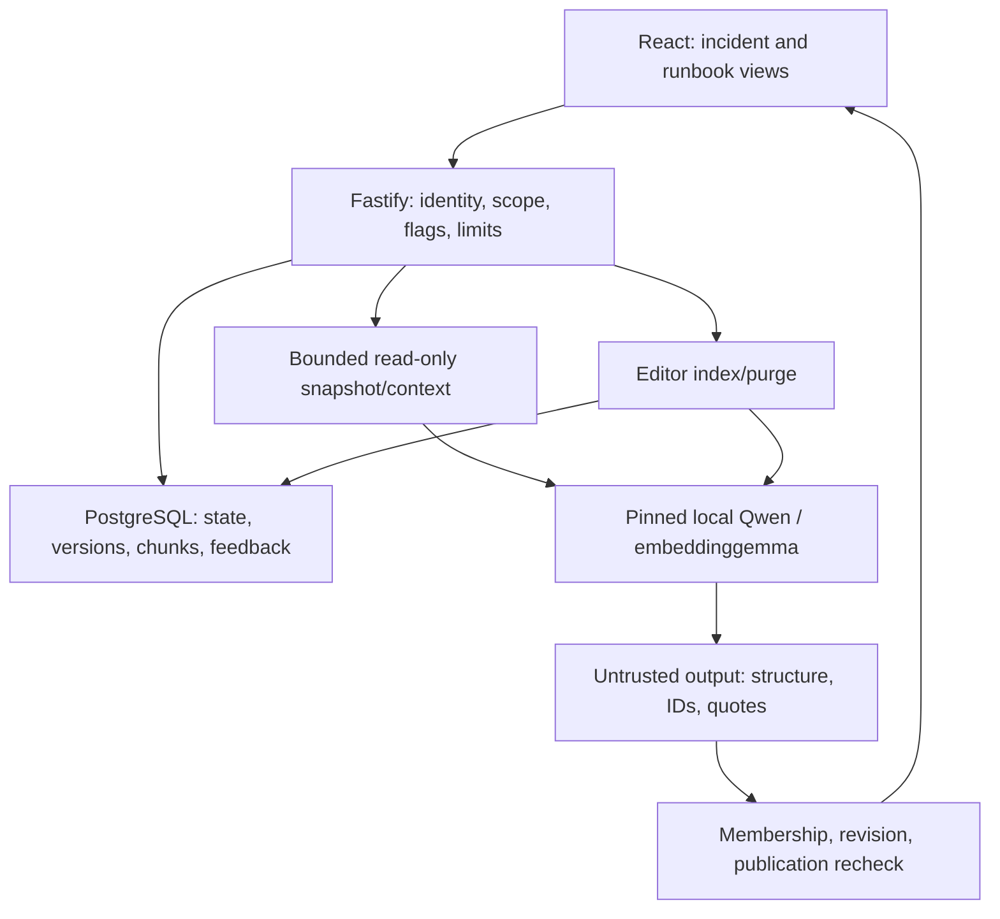

# M2 architecture and authority

SQL/application own state and source authorization. Generation releases database connections and never writes state. Scoped exact cosine retrieval ranks only current eligible sources in the pinned vector space. Derived chunk writes require editor rights and transaction rechecks; optional feedback is a separate signed metadata-only API write.

Source version/hash/chunk/span metadata resolve citations. Exact quotes establish identity, not truth. React renders plain text; outputs remain unverified. Providers have no tools, redirects or arbitrary endpoints, and have bounded budgets. AI/embeddings default off independently; conventional timelines and keyword search remain available. Existing async workers/private files retain deterministic boundaries.

This is an AI-assisted product. No operational agent, Phase 11 tools or autonomous action loop is present.
