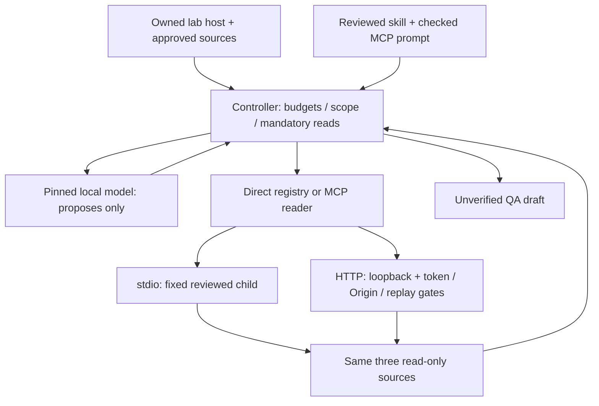

# M3 — Agent Foundations engineering report

**Current status: formally accepted for the limited foundations lab scope after focused lifecycle remediation.** Tested code a55fbe29bcfb5e78fdee4dc4c54b5cdca44be479; CI 37953380880 passed all required lanes. See [formal acceptance](m3-acceptance-check.md). Earlier notices below are historical; actual human checkpoint and live quality debt are preserved.

Phases preserved: 11 direct bounded QA agent, 12 MCP stdio fundamentals, 13 Skills and authenticated local HTTP. M2 remains formally accepted under its existing policy. PR #3 and #4 were merged only on explicit user orders, with two-parent merge commits and branches/history preserved. Phase 13 is on feat/m3-skills-http above main 95caf7486c0380a22bebe5c2c55a24419fcdf239.

| Gate | Current outcome |
|---|---|
| Phase 11 controller | scope/schema/integrity/coverage, six-turn/token/character/deadline gates; unverified drafts; engineering complete |
| Phase 12 protocol | actual SDK host/client/server, all three tool/resource parity in modern+legacy stdio; engineering complete |
| Phase 13 knowledge/HTTP | reviewed progressive skill, checked prompt, agent consumes MCP; local credential/security matrix; engineering complete; full branch CI green on 4510690 |
| Prior regressions | unconditional lint/types/build/audit/unit/native/AI/browser lanes retained; green: 48 units, 7 M3 + 6 MCP suites, 8 agent fixtures, 114 AI evals, 82 native integrations and 9 browser flows; [exact receipt](../evidence/phase13-ci-receipt.json) |
| Evidence | synthetic run traces, raw protocol transcript, context snapshot, HTTP matrix; no tokens/private traces committed |
| Learning | per-phase materials accumulated; completed; seven actual learner answers and architecture/scenario explanations recorded |
| Desktop | completed at 52b1f56; 9 runs / 54 calls / 9 turn_budget blocks / 0 drafts / 0 provider errors |
| Human semantic review | complete: blocked run accepted as safe denial; final draft review not applicable |
| M4 authorization | absent; stop before Phase 14 |

Architecture/current state:

No shell, generated code, operational incident action, test-suite execution, automatic CI verdict, public endpoint, private product-data adapter, framework or production OAuth platform was added. Skill/prompt/resource content is knowledge; authorization belongs to the executor/controller. The complete OpsLedger deterministic product and accepted M2 optional AI capability remain demonstrable locally.

Evidence links:
- [Phase 11 report](phase11-report.md), [controller traces](../evidence/phase11-agent-eval.json), [CI receipt](../evidence/phase11-ci-receipt.json)
- [Phase 12 report](phase12-report.md), [actual protocol transcript](../evidence/phase12-protocol-transcript.json), [CI receipt](../evidence/phase12-ci-receipt.json)
- [Phase 13 report](phase13-report.md), [context snapshot](../evidence/phase13-context-snapshot.json), [HTTP security matrix](../evidence/phase13-http-security-matrix.json)
- [M3 consolidated Teach-Back](m3-teach-back.md), [Desktop Validation Bundle](m3-desktop-validation.md)

Evaluation limits: fixed proposal fixtures prove policy, not Qwen tool-selection quality. Live task repetition measures variability only; no fresh bilingual calibrated held-out generalization or numeric semantic pass rate is inferred. No model/prompt quality promotion or product-value improvement over direct reading is claimed. Future promotion retains the agreed >=0.90 calibrated semantic support/answerability target and no critical unsupported operational claim in critical/adversarial cases.

Non-blocking lab debt: synthetic offline sources instead of private tenant adapter; JS egress rather than OS/native/child sandbox; cooperative cancellation rather than arbitrary rollback; local HTTP lacks TLS/production OAuth; reusable bearer is not proof-of-possession; limited model evals; GitHub private-plan main protection unavailable. These block broader deployment/security/production-quality claims. Required deterministic regressions and any real boundary failures are blocking and cannot be waived by quality scores.

Acceptance: M3 is NOT formally human-accepted yet. Desktop execution, selected material judgments and consolidated Teach-Back remain pending. Do not invent answers or mark pending evidence completed. Recommendation: complete this one milestone gate; proceed to M4 only after actual outcomes are recorded and the user explicitly authorizes it. No Phase 14 implementation.

Final engineering acceptance: all deterministic required gates passed on 4510690a9f10da7b094641c5cc0c52c398094f25, run 37859889444. No remaining engineering blocker in the stated lab scope. Desktop/human milestone acceptance gates remain outstanding and are not technical debt. M3 cannot be formally accepted until those actual outcomes are recorded. Conditional recommendation: proceed to M4 after that milestone gate and explicit user authorization; do not start it now.

## Windows desktop defect — actual failed attempt

The user attempted handoff 544f22edf55c4abd806751e693162d936c0aa7e0 on Windows / Node 24.19.0 with the unchanged M2 provider configuration. Stdio bootstrap failed before any of the nine agent runs. Node rejected a Windows filesystem path passed to --import with ERR_UNSUPPORTED_ESM_URL_SCHEME; the same file:// URL succeeded independently. This is a blocking cross-platform launcher defect, not model/provider/MCP quality evidence. The earlier Linux CI acceptance above remains historical and does not prove Windows compatibility. See [actual failed attempt](../evidence/m3-windows-startup-failure.json). M3 engineering acceptance is reopened until corrective Linux and Windows CI pass; desktop and human milestone gates remain outstanding. No Phase 14/M4.

## Corrective engineering acceptance — 2026-10-09

The Windows launcher defect is corrected on cf4c6f0c2a97bcc494eaeb2b2d5a39dcc16ea1d2. Actual CI run 37867155568 passed all three lanes: Windows Node 24.19.0 (8 MCP + 7 M3 tests, zero failures/skips), Linux API (48 units, 8 MCP + 7 M3 tests, 8 agent fixtures, 114 AI regressions, zero unexpected egress, 82 native integrations with zero skips, restore/baseline) and all nine browser flows; lint/types/build/audit green. [Exact receipt](../evidence/m3-windows-correction-ci-receipt.json), [correction/security review](m3-windows-launcher-correction.md). This supersedes the reopened engineering blocker, without replacing the failed desktop evidence or claiming successful local model runs. The final handoff successor changes documentation/evidence only; its executable code matches the tested corrective SHA. M3 desktop, human semantic sampling and Teach-Back remain pending; M3 is not formally accepted. Stop before Phase 14/M4.

## Actual M3 milestone checkpoint and acceptance check — 2026-10-09

The user completed the desktop/human checkpoint at 52b1f567766a0098313c5637e4ec6f00c7d54c0d: 9 agent runs, 54 provider calls, 0 provider errors, 0 drafts; all 9 safely blocked at six-turn turn_budget across direct/stdio/HTTP. Representative blocked run: Accept as safe controller denial. Final draft review: not applicable. Seven learner answers, two architecture flows, controlled failures and both Senior/Staff scenarios are recorded in [actual checkpoint](m3-human-checkpoint.md); no additional answers or judgments inferred. No desktop/Teach-Back rerun or model/prompt/budget change.

The 9/9 bounded blockage is poor/inconclusive live model quality, not transport failure or successful task completion. It does not violate the Phase 11–13 foundations DoD by itself; provisional tool-selection release quality is not demonstrated. Formal M3 acceptance is nevertheless **blocked** by the later required browser lifecycle CI failure on this handoff (run 37867546978), despite API/Windows passing and earlier corrective CI being green. [Formal acceptance check](m3-acceptance-check.md) distinguishes this engineering blocker from model debt. Earlier pending-human notices are historical and superseded; actual checkpoint is complete, milestone acceptance remains pending engineering resolution. PR #5 unmerged; no Phase 14/M4 authorization.

## Formal M3 closure after focused lifecycle remediation — 2026-10-09

M3 is formally accepted for the limited Agent Foundations lab scope at tested code a55fbe29bcfb5e78fdee4dc4c54b5cdca44be479. Full CI run 37953380880 passed API/browser/Windows; controlled native evidence changes from mutation SQLSTATE 40P01 to both handlers committed under identical lock overlap. Five targeted native lifecycle browser runs and all nine full browser flows passed, along with 83 native integrations without skips and unchanged security/AI checks. [Acceptance](m3-acceptance-check.md), [causal remediation](m3-lifecycle-remediation.md), [exact receipt](../evidence/m3-lifecycle-remediation-ci-receipt.json).

This supersedes the previously unresolved lifecycle blocker. Original failure evidence and actual human checkpoint remain preserved. The desktop outcome is still 9/9 safe turn_budget blocks, zero drafts: poor/inconclusive live quality, not promoted model quality or product benefit; provisional release targets remain unproven. No desktop/Teach-Back repeat or AI changes. No required M3 blocker remains; non-blocking limited-lab debt stays documented. PR #5 remains open/unmerged. Recommendation: M4 only after explicit authorization; no Phase 14/M4 has begun. This update changes no roadmap phase scope, DoD or threshold.
