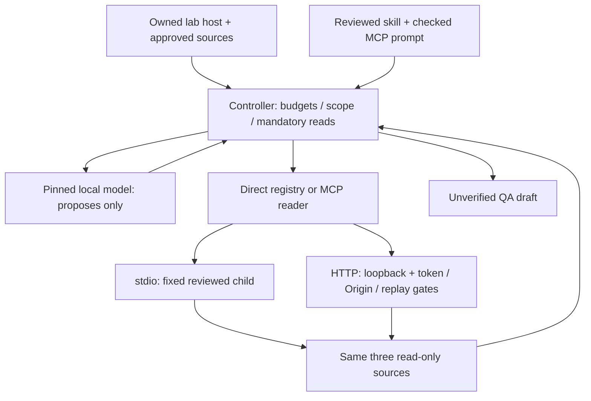

# M3 — Agent Foundations engineering report

Phases preserved: 11 direct bounded QA agent, 12 MCP stdio fundamentals, 13 Skills and authenticated local HTTP. M2 remains formally accepted under its existing policy. PR #3 and #4 were merged only on explicit user orders, with two-parent merge commits and branches/history preserved. Phase 13 is on feat/m3-skills-http above main 95caf7486c0380a22bebe5c2c55a24419fcdf239.

| Gate | Current outcome |
|---|---|
| Phase 11 controller | scope/schema/integrity/coverage, six-turn/token/character/deadline gates; unverified drafts; engineering complete |
| Phase 12 protocol | actual SDK host/client/server, all three tool/resource parity in modern+legacy stdio; engineering complete |
| Phase 13 knowledge/HTTP | reviewed progressive skill, checked prompt, agent consumes MCP; local credential/security matrix; engineering complete; full branch CI green on 4510690 |
| Prior regressions | unconditional lint/types/build/audit/unit/native/AI/browser lanes retained; green: 48 units, 7 M3 + 6 MCP suites, 8 agent fixtures, 114 AI evals, 82 native integrations and 9 browser flows; [exact receipt](../evidence/phase13-ci-receipt.json) |
| Evidence | synthetic run traces, raw protocol transcript, context snapshot, HTTP matrix; no tokens/private traces committed |
| Learning | per-phase materials accumulated; one M3 consolidated checkpoint prepared, actual answers pending |
| Desktop | one actual pinned-provider direct/stdio/HTTP bundle prepared; hardware run pending |
| Human semantic review | selected material samples only; actual judgments pending |
| M4 authorization | absent; stop before Phase 14 |

Architecture/current state:

No shell, generated code, operational incident action, test-suite execution, automatic CI verdict, public endpoint, private product-data adapter, framework or production OAuth platform was added. Skill/prompt/resource content is knowledge; authorization belongs to the executor/controller. The complete OpsLedger deterministic product and accepted M2 optional AI capability remain demonstrable locally.

Evidence links:
- [Phase 11 report](phase11-report.md), [controller traces](../evidence/phase11-agent-eval.json), [CI receipt](../evidence/phase11-ci-receipt.json)
- [Phase 12 report](phase12-report.md), [actual protocol transcript](../evidence/phase12-protocol-transcript.json), [CI receipt](../evidence/phase12-ci-receipt.json)
- [Phase 13 report](phase13-report.md), [context snapshot](../evidence/phase13-context-snapshot.json), [HTTP security matrix](../evidence/phase13-http-security-matrix.json)
- [M3 consolidated Teach-Back](m3-teach-back.md), [Desktop Validation Bundle](m3-desktop-validation.md)

Evaluation limits: fixed proposal fixtures prove policy, not Qwen tool-selection quality. Live task repetition measures variability only; no fresh bilingual calibrated held-out generalization or numeric semantic pass rate is inferred. No model/prompt quality promotion or product-value improvement over direct reading is claimed. Future promotion retains the agreed >=0.90 calibrated semantic support/answerability target and no critical unsupported operational claim in critical/adversarial cases.

Non-blocking lab debt: synthetic offline sources instead of private tenant adapter; JS egress rather than OS/native/child sandbox; cooperative cancellation rather than arbitrary rollback; local HTTP lacks TLS/production OAuth; reusable bearer is not proof-of-possession; limited model evals; GitHub private-plan main protection unavailable. These block broader deployment/security/production-quality claims. Required deterministic regressions and any real boundary failures are blocking and cannot be waived by quality scores.

Acceptance: M3 is NOT formally human-accepted yet. Desktop execution, selected material judgments and consolidated Teach-Back remain pending. Do not invent answers or mark pending evidence completed. Recommendation: complete this one milestone gate; proceed to M4 only after actual outcomes are recorded and the user explicitly authorizes it. No Phase 14 implementation.

Final engineering acceptance: all deterministic required gates passed on 4510690a9f10da7b094641c5cc0c52c398094f25, run 37859889444. No remaining engineering blocker in the stated lab scope. Desktop/human milestone acceptance gates remain outstanding and are not technical debt. M3 cannot be formally accepted until those actual outcomes are recorded. Conditional recommendation: proceed to M4 after that milestone gate and explicit user authorization; do not start it now.
