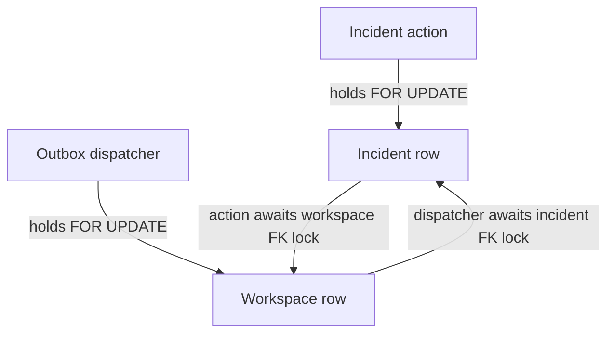

# Focused M3 browser lifecycle remediation — 2026-10-09

## Failure and classification

Original gate: run 37867546978, handoff 52b1f567766a0098313c5637e4ec6f00c7d54c0d, browser lifecycle after Reopen could not show Resolution summary. Preserve [original receipt](../evidence/m3-handoff-ci-failure.json). The original workflow uploaded evidence/* only, while failed Playwright screenshot/trace/error context lived under test-results/. Artifact metadata was inspected; fetching its reusable archive reference into scratch returned HTTP 403. No original screenshot/trace contents are claimed inspected. Original test-mode backend logging did not expose a per-request SQLSTATE.

With the product unchanged, instrumented native browser run 37952011139 at 99cd2120a2b76c63ea61b4cb17548e06f69143a9 reproduced the same failure: reason form valid, Reopen POST submitted with expectedRevision=6, response HTTP 500/internal_error, UI still closed/revision 6 with a visible Service unavailable alert. Therefore the reproduced failure is a submitted request that failed server-side, not a missing click or a successful commit hidden by UI rendering. [Before evidence](../evidence/m3-lifecycle-before-fix.json).

A controlled native test at 971b1447f133bf6d794388359b6e073866846cd0, run 37952941824/job 113896126674, uses the real Store.act and AsyncOps.dispatch with barriers after their real row-lock queries. It deterministically rejected the mutation with SQLSTATE 40P01, while dispatch fulfilled. This establishes the native locking defect independently of a later green rerun. The exact SQLSTATE of the historical uninstrumented request cannot be recovered; the matching reproduced browser failure and native causal proof are distinguished explicitly.

## Root cause

Incident mutation locks the incident FOR UPDATE, then writes audit/outbox records whose workspace foreign keys require a workspace KEY SHARE lock. Concurrent outbox dispatch locks the workspace FOR UPDATE, then inserts notification async_operations whose incident foreign key requires an incident KEY SHARE lock. Each transaction holds the row needed by the other: PostgreSQL detects the cycle and rolls back one. If the incident action is the victim, the API safely returns HTTP 500 and the UI retains closed state. PGlite's one-client harness serializes transactions and cannot expose this native concurrent lock cycle.

## Smallest product correction / security review

Only the incident-row lock in Store.act changes to FOR NO KEY UPDATE, with an explanatory comment. These actions update non-key state/assignee/resolution/revision/timestamp fields, not incident identity/workspace keys. NO KEY UPDATE remains exclusive against competing mutations, UPDATE/DELETE and FOR SHARE, but is compatible with reference-only FOR KEY SHARE. The dispatcher can finish its FK check and release the workspace, breaking the proven cycle.

Membership locks, workspace scope, role checks, expectedRevision, conditional UPDATE, atomic activity/audit/outbox writes, transaction rollback and client error presentation remain enforced. The existing native concurrent-revision test still requires two distinct blocked backends and exactly one commit / one revision_conflict; only its observed query text is updated for the new lock. No migration, constraint, permission or arbitrary command/model capability changes. Official [PostgreSQL 18 row-lock compatibility](https://www.postgresql.org/docs/18/explicit-locking.html#LOCKING-ROWS) was checked.

## Deterministic regression and browser evidence

The new native lifecycle-outbox integration test holds the real mutation after incident locking until the real dispatcher owns its workspace lock. No sleeps, transaction retry or altered deadlock configuration. Before correction: mutation rejected with 40P01. After correction: both handlers must fulfill, persisted incident investigating/revision 7/resolution null, exactly one reopen activity, exactly one revision-7 outbox event and notification work exists. It is added to the full integration runner; the focused native step also runs before the full suite. PGlite explicitly skips this native-only proof and is not used to claim native locking correctness.

The browser test retains all original lifecycle/stale-tab/reload assertions and adds strict request/response/state checks. Its real Reopen response is held after the actual server commit: GET confirms investigating/7 while the client still shows closed/6 and disabled Reopen. On delivery, HTTP 200 and investigating/7, Resolution summary and revision-7 activity must be visible with no alert. This forces server/client timing separation without arbitrary timeout increases, sleeps, retries, weakened assertions or a fake response.

Synthetic diagnostic artifacts/logs record action/revision/result and UI, never cookies, passwords or authorization headers. Five fresh server lifetimes run the targeted lifecycle browser check in native CI before the unchanged full browser suite. Local supplemental checks: lint/types/build and six controlled-response browser runs passed on Chromium 153/PGlite; CI uses pinned Playwright Chromium 156 and PostgreSQL 18.6/pgvector 0.8.7. Temporary local Chromium unpacked outside the repo is not a project dependency or lockfile change. Early diagnostic-only revisions failed syntax/type checks and were corrected; those are not root-cause evidence or successful remediation validation.

## Exact after validation

Tested corrective code: a55fbe29bcfb5e78fdee4dc4c54b5cdca44be479. Full run 37953380880 passed API, browser and Windows. The identical controlled native overlap fulfills both handlers; all five native targeted lifecycle browser runs plus all nine full browser flows passed. Full native integration: 83 tests, zero skips; units 48; MCP 8; M3 7; agent fixtures 8; AI regressions 114, zero unexpected egress; lint/types/build/audit/restore/baseline green. [Exact before/after and CI attestation](../evidence/m3-lifecycle-remediation-ci-receipt.json). No unresolved required gate remains in this code state. M3 is formally accepted for the limited Agent Foundations lab scope, with its recorded live quality debt intact.

No M3 desktop bundle or Teach-Back was rerun. Actual human records and 9/9 live turn_budget quality debt remain unchanged. No AI/model/prompt/budget/MCP change, PR #5 merge or Phase 14/M4.
