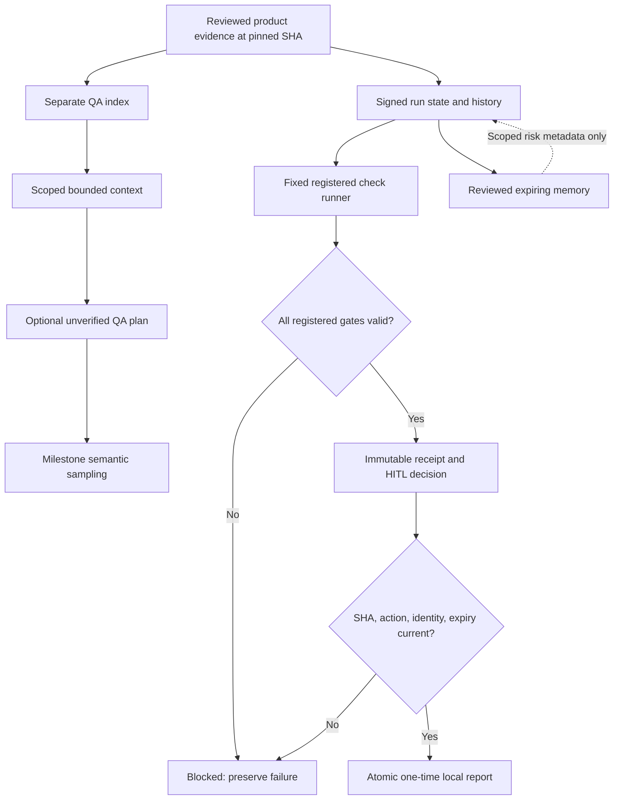

# M4 current architecture and data flow

The diagram distinguishes the experimental QA-plan lane from the adopted deterministic workflow. QA retrieval is rejected for default adoption; memory contains reviewed risk codes/provenance, never instructions or free-text transcripts. The current controller does not automatically feed stored memory or probabilistic plan output into execution. The dotted edge exposes authorized memory metadata on run reads, not model instructions or tool grants. Desktop plan samples are reviewed at the milestone and are not automatically attached to an executable workflow/report.

Phase 14 source provenance pins the unchanged product evidence baseline c55eee55fcfeb4c31e0b252a1573156e2a9d41b4. A workflow's target SHA is separately the exact current reviewed executable checkout. Run contextHash hashes the registered source manifest; the desktop experiment separately hashes each actual assembled prompt-source context. Do not conflate these hashes or assume either proves truth.

Session → current active membership → owner/workspace-scoped signed checkpoint. Fixed executable/arguments → actual check receipt → current membership/SHA recheck. Approval → immutable action/receipt/context binding → current reviewer/expiry/replay check → report/state/history commit in one transaction. Long check execution holds no DB connection/authorization lock; app revalidation occurs after it. A replayed read-only suite may occur after lease expiry, but a stored report effect is unique and atomic.

Full CI remains independent; local lab checks cannot grant a merge/release verdict. No arbitrary code, shell, incident actions, auto-merge, n8n or specialists. Existing direct/MCP/Skill, AI/RAG and egress boundaries remain authoritative.
