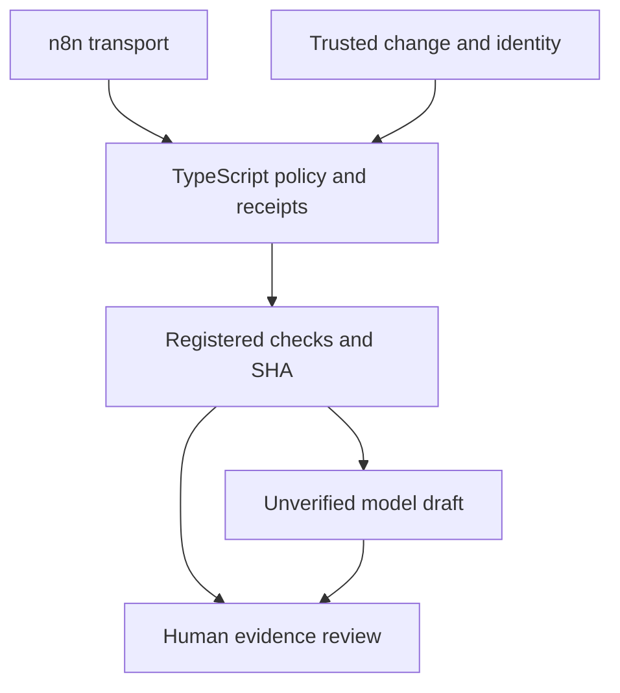

# M5 — advanced QA engineering report

The consolidated actual human/desktop checkpoint is complete on implementation SHA 15dba1139bfd8291500a87aecb6510ad99797a75. Phase 17 CI 38008991379, Phase 18 CI 38009794558 and Phase 19 CI 38010338598 are green on their recorded engineering heads. The documentation/evidence-only checkpoint successor still requires full API/browser/Windows CI before formal limited-scope M5 acceptance. PR #7 records that resulting head/run/decision without a later docs-only successor solely to record green.

## Results and recommendation

- n8n Community 2.42.6 executes actual signed HTTP orchestration, denial/error branches, duplicate recovery and scrubbed export. It coordinates the existing scoped TypeScript authority; it adds no policy authority. This demonstrates transport integration, not better semantic QA or exactly-once delivery.
- Authenticated Docker Hub resolves registry reliability on pinned PostgreSQL 18.6 and n8n 2.42.6. Private step-local secrets/password-stdin/temp config/always cleanup passed. Existing version tags are preserved, not upgraded to claimed immutable digest pins; authentication supplies no new image provenance/signature guarantee. Review: phase17-registry-remediation.md.
- Specialist tools/handoff preserve parent context/identity; hostile peers, context loss and conflicts are denied/inconclusive. Controlled paired labels are equal by construction, with 3x calls and fixture token proxy. Reject default adoption: no demonstrated semantic gain justifies the extra operational/security complexity. Actual live results and human judgments now reinforce rejection: each mode has two exact known-label matches across eight paired outputs; reopening/isolation/audience representative samples were Reject, missing evidence Accept. Specialists use 24 calls versus 8, 14109/13671 reported tokens versus 4284, and 67623.6195/62884.620899999994 ms versus 22897.514500000027 ms. These are small known synthetic measurements, not calibrated quality, billing or product-value claims.
- End-to-end direct QA selects minimum/additional registered suites, executes SHA-bound checks and produces an unverified human-review artifact. Any failed required check dominates the model. No arbitrary shell, incident mutation, auto-approval, merge or release.

Recommendation: retain the direct baseline and experimental retrieval policy. Treat n8n as a learning/integration option and specialists as a rejected default. Neither is established as a product-quality improvement.

## Architecture/data flow

Flow A: the operator signs a fixed event for an existing run. n8n authenticates its webhook and sends the body/signature to the scoped TypeScript service. TypeScript revalidates identity/SHA/expiry, owns deterministic checks/receipt/approval policy and durable event handling. A separately human-approved specific M4 receipt can permit only one local report write. n8n never approves or bypasses checks.

Flow B: trusted parent change metadata enters deterministic risk routing. Four minimum and selected extra registered suites execute on the verified checkout. Evidence and unchanged bounded identity enter direct triage, or the optional measured specialist variants. Mechanical evaluation rejects bad contracts and disagreements. The final artifact goes to human review; no automatic side effect follows.

## Preserved caveats

Community/self-hosted n8n is not an OS sandbox. JS egress guards are application controls, not hostile native-process confinement. Trusted CI/repository code and owned synthetic data are prerequisite. Signed bodies/hashes provide binding/integrity, not semantic correctness. Transport is not exactly once. Fixtures are not live model quality or actual human approval. Failed/inconclusive remains a valid outcome. M3's 9/9 turn-budget failure and M4's actual human retrieval judgments remain intact; retrieval is not adopted by default. No paid/cloud model, model retuning, product mutation, arbitrary generated command, merge/release authority or M6 work.

## Completed human checkpoint and final CI gate

The user ran exactly one live desktop bundle on the reviewed implementation, completed material semantic/security review, passed questions 1–7, architecture flows A/B, selected failure demonstrations and both Senior/Staff scenarios. See m5-human-review.md, m5-teach-back.md and evidence/m5-human-checkpoint.json. Original desktop values and false automatic acceptance/adoption/authority flags are preserved separately from subsequent human judgment. No M4 rerun or retuning.

All human/desktop requirements are satisfied. Full required CI on the checkpoint-recording successor is the final formal gate: green = accepted for limited M5 scope, otherwise blocked. The PR run/check records the final decision. Reject default specialists and retain no default retrieval adoption; no semantics/product-value promotion. Stop here; PR #7 unmerged/draft and no Phase 20/M6 authorization.
