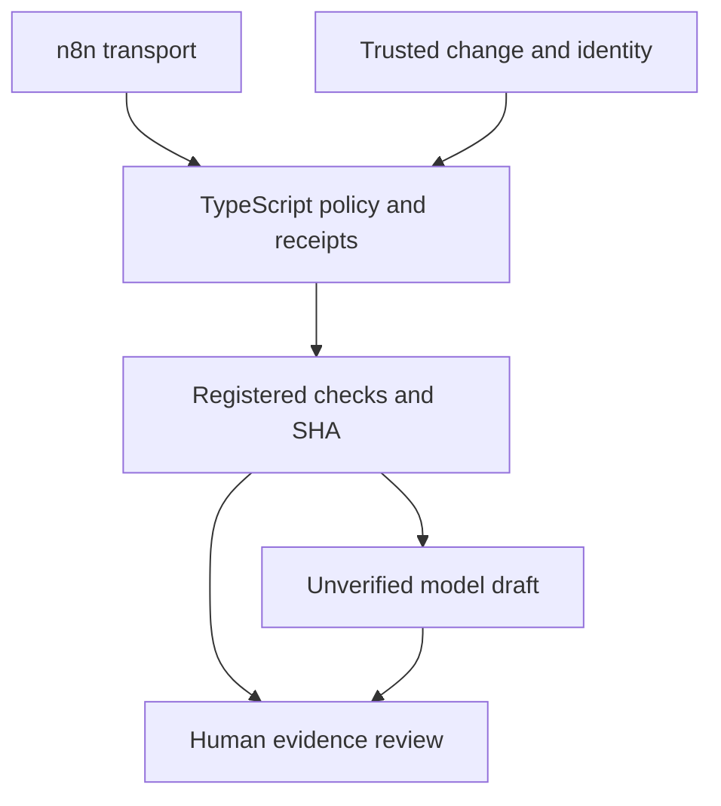

# M5 — advanced QA engineering report

M5 is not formally accepted. Phase 17 final-head CI is green (1b5c2fba335d69b7957ba408f8c612d1998fd0d7 / 38008991379). Phase 18 comparison CI is green (c06bc4b3ab7c5830a8da8ef63328f5ba2e412d26 / 38009794558). Phase 19 final-head CI and the consolidated human/desktop checkpoint are required. The final PR/run/check records close the current-head gate without a documentation-only successor solely to record green.

## Results and recommendation

- n8n Community 2.42.6 executes actual signed HTTP orchestration, denial/error branches, duplicate recovery and scrubbed export. It coordinates the existing scoped TypeScript authority; it adds no policy authority. This demonstrates transport integration, not better semantic QA or exactly-once delivery.
- Authenticated Docker Hub resolves registry reliability on pinned PostgreSQL 18.6 and n8n 2.42.6. Private step-local secrets/password-stdin/temp config/always cleanup passed. Existing version tags are preserved, not upgraded to claimed immutable digest pins; authentication supplies no new image provenance/signature guarantee. Review: phase17-registry-remediation.md.
- Specialist tools/handoff preserve parent context/identity; hostile peers, context loss and conflicts are denied/inconclusive. Controlled paired labels are equal by construction, with 3x calls and fixture token proxy. Reject default adoption: no demonstrated semantic gain justifies the extra operational/security complexity. Actual live results and human judgments remain pending; no semantic percentage/value claim.
- End-to-end direct QA selects minimum/additional registered suites, executes SHA-bound checks and produces an unverified human-review artifact. Any failed required check dominates the model. No arbitrary shell, incident mutation, auto-approval, merge or release.

Recommendation: retain the direct baseline and experimental retrieval policy. Treat n8n as a learning/integration option and specialists as a rejected default. Neither is established as a product-quality improvement.

## Architecture/data flow

Flow A: the operator signs a fixed event for an existing run. n8n authenticates its webhook and sends the body/signature to the scoped TypeScript service. TypeScript revalidates identity/SHA/expiry, owns deterministic checks/receipt/approval policy and durable event handling. A separately human-approved specific M4 receipt can permit only one local report write. n8n never approves or bypasses checks.

Flow B: trusted parent change metadata enters deterministic risk routing. Four minimum and selected extra registered suites execute on the verified checkout. Evidence and unchanged bounded identity enter direct triage, or the optional measured specialist variants. Mechanical evaluation rejects bad contracts and disagreements. The final artifact goes to human review; no automatic side effect follows.

## Preserved caveats

Community/self-hosted n8n is not an OS sandbox. JS egress guards are application controls, not hostile native-process confinement. Trusted CI/repository code and owned synthetic data are prerequisite. Signed bodies/hashes provide binding/integrity, not semantic correctness. Transport is not exactly once. Fixtures are not live model quality or actual human approval. Failed/inconclusive remains a valid outcome. M3's 9/9 turn-budget failure and M4's actual human retrieval judgments remain intact; retrieval is not adopted by default. No paid/cloud model, model retuning, product mutation, arbitrary generated command, merge/release authority or M6 work.

## Remaining milestone gate

Use m5-human-review.md, m5-teach-back.md and m5-desktop-validation.md. Exactly one desktop bundle runs only the new approved local-model comparison; CI already covers native PostgreSQL, n8n and browser/Windows plumbing. No accepted M4 bundle rerun. Formal acceptance requires actual evidence and human judgments; an insufficient-benefit Reject result is valid. The acceptance check must remain pending until those records exist.
