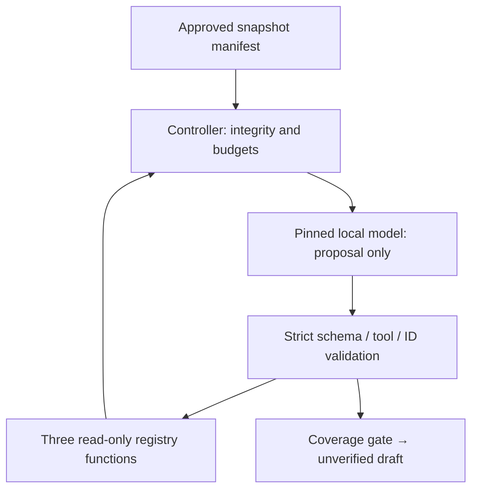

# Phase 11 authority and security review

There are no commands, paths, model-selected URLs, DB credentials, write handlers or product API routes in this registry. The offline caller constructs the approved manifest; tools resolve only its opaque IDs. Frozen copied sources prevent later caller mutation. Model/tool text cannot alter the registry, conditional CI or mandatory controller checks.

Claims remain untrusted even after full source coverage. Poisoned evidence may influence draft content; deterministic denial fixtures prove executor restrictions, not universal LLM resistance. No numeric live-agent quality pass rate is inferred. No operational authority is added.

Six-turn/character/token/deadline limits bound the harness. Tokens are provider-reported metadata, not an independent tokenizer attestation. An arbitrary provider may continue computation after the harness stops; reviewed local Ollama has its own request deadline and no tool can execute after termination. Process-level egress guard is not OS/native/child-process isolation.

Source text is bounded synthetic data in the shipped fixture. Do not replace it with private workspace data without a real authorization/scoping adapter, reviewed redaction and current-source lifecycle checks. No arbitrary executable providers are safe to run. The live script exports only the fixed synthetic task into ignored desktop-private evidence.

No new dependency. Existing generation pinning, local-only origin/redirect denial and M2 optional-unverified policy remain. Registered test execution, MCP transport and agent operational authority are absent.
