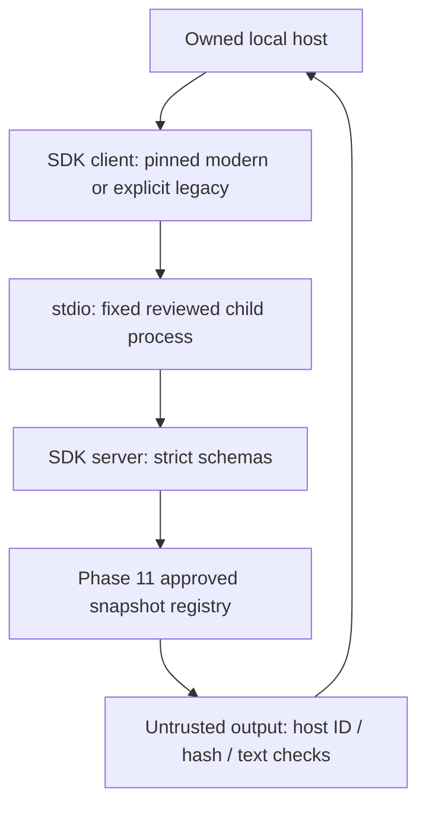

# Phase 12 — Security and compatibility

The trust boundary is operator-approved local code and synthetic source manifest, not MCP metadata. Discovery does not grant tool authority. Model/tool text cannot choose an executable, argument path, URL, tenant, state transition or CI verdict. A hash proves immutable bytes, not truth.

| Component | Validated version/behavior | Limit |
|---|---|---|
| Node | Work 24.19.0; CI pinned 24.19.0 | Other runtimes not claimed |
| Official SDK | server/client/core 2.3.1 in lockfile | No unpinned downloads |
| Modern stdio | 2026-07-28 pinned SDK client | No HTTP/auth transport claim |
| Legacy stdio | 2025-11-25 explicit SDK client + actual raw transcript | No arbitrary third-party host claim |
| Tools/resources | Three of each; exact direct parity in both eras | Synthetic offline scope, no private product access |
| Cancellation | Timeout and AbortSignal, cooperative fixture confirms cancellation in both eras | No arbitrary provider/side-effect rollback guarantee |
| Egress | JS guard in host and explicitly configured children | No OS/native/child-process sandbox |
| Diagnostics | stderr; stdout JSON-RPC only, 16 KiB incoming buffer bound | No raw private payload logging |

Input schemas reject extra fields, malformed IDs and invalid types. Registry denies valid-looking foreign IDs. Resources register exact version/hash URIs and reject file/stale/unlisted URIs. Host rejects missing/forged structured output, mismatched display text and semantic authority flags. A malicious but approved source can still affect future AI text; no universal injection resilience or production quality is claimed.

The allowlist function exposes protocol-era choice only, not command/argv/env configuration. No .env or credentials are loaded by the server. Child executables are reviewed trusted code with normal OS permissions. Runtime dependencies add only official pinned SDK packages and their locked transitives; audit is required. No public port, HTTP auth, remote deployment or operational tools are included.
