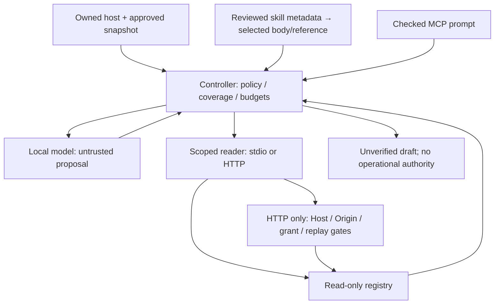

# Phase 13 security review

The offline approved synthetic manifest is the source boundary. This is not real OpsLedger tenant authentication. Registry IDs, hashes and exact resource URIs remain deterministic. Skills, prompt metadata, source statements and model text grant no executable capabilities.

| Gate | Denial exercised | Enforcement |
|---|---|---|
| Skill/reference review | altered bytes, allowed-tools injection, malicious reference | pinned reviewed digests, narrow format |
| MCP prompt | extra malicious instructions | exact reviewed text before inference |
| Agent authority | unknown shell, early finish, forged/late reader output | strict proposal, scope, coverage, output equality, deadline |
| Local endpoint | foreign Host; evil/null Origin | exact endpoint Host/Origin; binds 127.0.0.1 only |
| Credentials | missing/invalid/expired/revoked grant | random opaque in-memory grant lookup + SDK bearer gate |
| Scope/audience | missing qa:read, wrong resource | SDK requiredScopes/expectedResource |
| Replay | repeated request-ID | bounded 512-entry / five-minute cache; no unexpired eviction |
| Request resources | missing ID, malformed RPC, >16 KiB body | validation and SDK/Node body bounds; 8 connections / 5 s request headers |
| Transport egress | remote and unregistered loopback | reviewed JS guard, explicitly configured stdio children |

Replay limitation: possession of a reusable bearer plus a new request ID is not stopped by the nonce cache. Do not describe this as proof-of-possession protection. Local HTTP has no TLS and no production OAuth provider; the client forbids redirects and alternate origins. Tokens and private model traces are not logged or versioned.

Skill integrity proves reviewed bytes, not semantic truth. An approved malicious source can still contaminate an AI draft. The model cannot mutate data, execute code, mint credentials, change budgets, skip CI or approve release. Egress patches are not OS/native/child isolation. Cancellation is cooperative and does not prove rollback.

Repository main protection remains unavailable under the previously recorded private-plan restriction. PR/check/merge-commit discipline is procedural. No sandbox or production model quality is falsely claimed.
