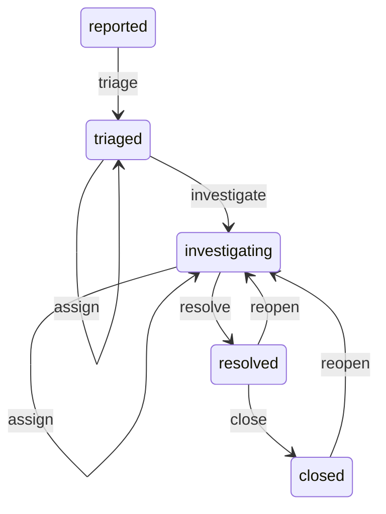

# Phase 2 architecture and contract

## Fixed lifecycle

Comments preserve state and increase revision in any state. No generalized update endpoint exists. History starts with accepted actions at revision 2; creation is represented by the incident's revision 1, not a fabricated historical event.

| Action | States | Roles | Required data |
|---|---|---|---|
| triage | reported | responder, lead | active workspace responder/lead assignee |
| assign | triaged, investigating | responder, lead | active workspace responder/lead assignee |
| investigate | triaged | responder, lead | current assignment must remain active/qualified |
| resolve | investigating | lead | resolution summary, 10–5000 code points |
| close | resolved | lead | persisted resolution retained |
| reopen | resolved, closed | lead | reason, 10–5000 code points; optional replacement assignee |
| comment | any | any active membership | plain text, 1–5000 code points |

All actions require expectedRevision. Roles come from current membership, never a submitted claim. Admin/editor roles do not imply operational lead rights. Closing/resolving can finalize an incident even when its prior assignee has since been revoked. Reopening revalidates assignment and accepts an active replacement atomically, avoiding a stuck incident.

## HTTP contract

POST /api/v1/workspaces/:workspaceId/incidents/:incidentId/actions uses a strict discriminated action schema. It returns the updated Incident DTO. Unknown authority fields fail 400. Unauthorized roles fail 403; inaccessible workspace/object/assignee fails 404. A stale revision yields 409 revision_conflict. An invalid state/action pair yields 409 invalid_transition. Roles are checked before revision disclosure; revision is checked before evaluating a transition on changed state.

GET .../activity returns items and nextBeforeRevision, ordered revision descending with pageSize 1–100 (default 50). beforeRevision is an exclusive pagination boundary. GET /api/v1/workspaces/:workspaceId/assignees lists active responder/lead users. Both require active workspace membership. History/comment notes are escaped by React and never rendered as HTML.

## Transaction boundary

Resolve the authenticated user, BEGIN, lock active actor membership FOR SHARE, then lock the scoped incident FOR UPDATE. Check role and expected revision. Compute the legal next state in the domain module. Lock/revalidate relevant assigned membership. Update with a revision predicate; insert activity; insert comment if applicable; validate the DTO; COMMIT. Any failure rolls all these writes back.

The row lock ensures concurrent native transactions compare against the committed current revision; the UPDATE predicate provides another guard. Each successful command increases revision once. Unique incident/revision history prevents duplicate action entries. Shared membership locks prevent concurrent membership changes during authorization/assignment checks. DB constraints enforce qualified relationships, positive revision, allowed state values and non-null resolution for resolved/closed states. They do not replace the application transition/RBAC policy.

Database lifecycle constraints are added by migration 0002-lifecycle.sql. Earlier migrations are unchanged. No Phase 3 audit/search/runbook work is included. Activity is application history, not a claim of independently tamper-proof auditing.

## Validation boundaries

PGlite runs serialize SQL through one pooled client. Two HTTP requests can overlap and produce 200/409, proving the revision behavior in that harness. That is not evidence of concurrent native backends.

The native-only test holds an incident row lock, starts two domain commands, observes two distinct pg_stat_activity backend PIDs waiting on the lock, releases it and expects one commit/one revision conflict. It is configured but was skipped locally because the environment cannot switch to a non-root user to run PostgreSQL. CI targets PostgreSQL 18.6 and must provide real results before full completion.

Browser acceptance uses two tabs and preserves a rejected comment draft. Explicit refresh reads the new revision; no automatic resubmission. The pinned Playwright driver uses the previously downloaded Chromium 141 executable override locally. Default browser download parity and native deployment remain pending.
