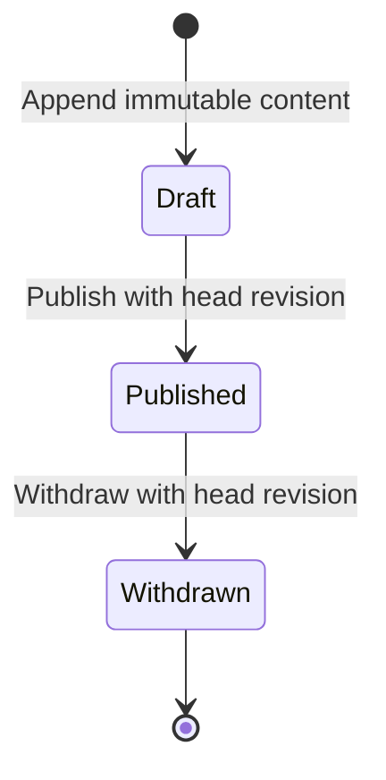

# Phase 3 architecture and contracts

## Publication and stable references

Runbook heads hold immutable workspace/service scope, latest version, current published pointer and optimistic revision. Content is appended to numbered versions. SHA-256 covers canonical title, body, category and service ID. Content, author and creation time cannot be updated or deleted through normal SQL mutations. Publication status is mutable under application policy. Publish accepts draft only; withdraw accepts published only; withdrawn content requires a new version to publish again. Publishing an older draft is permitted with a current head revision. The pointer identifies exactly one current version; withdrawal never resurrects an older publication.

A citation is /api/v1/workspaces/{workspace}/runbooks/{id}/versions/{number} plus contentHash. Its content/hash remain fixed; status and head revision may change. Older published versions remain readable by active members until explicitly withdrawn, while keyword results list only the current published pointer. A withdrawn citation returns 404 to readers and remains available to editors/admins for review. Draft/withdrawn search is an explicit management mode.

## Query and ACL matrix

| Identity | Published search / version | Draft or withdrawn search / version | Create, append, publish, withdraw | Audit |
|---|---|---|---|---|
| Active reporter/responder/lead | Allowed within workspace | 403 search / 404 version | 403 | 403 |
| Active editor/admin | Allowed within workspace | Allowed within workspace | Allowed with current revision | Allowed within workspace |
| Revoked or other workspace | 404 | 404 | 404 | 404 |
| Unauthenticated | 401 | 401 | 401 | 401 |

All routes load identity and server membership; request roles are rejected by strict schemas. Optional service IDs must identify active services in the same workspace. Incident role policy remains separate.

| Query | Expected evidence |
|---|---|
| worker timeout | Seeded published matches; PostgreSQL simple websearch query |
| title/newest, page size 3 | 18 initial North publications exactly once despite equal titles/times |
| newest, page size 1, distinct microseconds | All three versions returned, preserving database timestamp precision in cursor |
| category + service | Only matching scoped publications |
| draft, withdrawn | Management-only results |
| changed query/filter/sort/user/workspace cursor | 400 invalid_cursor; signature and scope verified |
| SQL-looking query | Bound parameter; no SQL injection |
| malicious Markdown | Literal escaped text, no executable DOM or javascript links |

Search uses generated tsvector plus GIN, websearch_to_tsquery('simple', q), C-collated title/UUID/version ordering or descending timestamp/UUID/version. HMAC cursors bind user, workspace, keyword, status, sort, filters and page size. Timestamp keys preserve six fractional digits rather than JavaScript millisecond truncation; incident pagination uses the same precision fix. This is keyset pagination, not a snapshot across concurrent publications. No relevance ranking, stemming, semantic search, embeddings, model call or source parser.

## Audit transaction boundary

Knowledge writes lock active membership, then scoped head, check role/revision, change version or publication, append metadata audit and commit. Incident creation uses one atomic insert/audit CTE; incident commands append audit within their existing activity/comment transaction. Audit failure rolls back the domain write. Test-only failure triggers prove this behavior for all three paths. SQL clients are explicitly leased/released on expected errors so the single-connection test adapter does not mask rollback with a reconnect race.

Events contain sequence, workspace, actor, action, object type/ID, revision, request ID and timestamp. No content body, search text, password, cookie or authorization value is stored. Audit read is bounded and scoped, newest sequence first. Successful writes are atomic; authenticated 403/404 denials are best-effort metadata events only when the actor has a membership record in the named workspace. An unrelated actor does not create a row in a foreign workspace. Unauthenticated requests are not logged as authenticated denials.

UPDATE/DELETE triggers protect audit rows against ordinary mutations. This is not independent tamper evidence: privileged DDL, TRUNCATE and database operators can bypass these controls. Direct privileged SQL can also bypass publication policy. Pre-migration incident history is retained without fabricated audit backfill. Request logs omit query strings and redact auth/cookies.

## Seed and availability

24 deterministic UUIDs: North 20, South 4. North #3 withdrawn, #4 draft, #5 withdrawn version 1/current published version 2, #6 adversarial Markdown; #1/#2 share titles; all seeded creation timestamps tie. Initially North exposes 18 published heads. Category rotates operations/recovery/security. Seed repeat preserves versions, hashes, membership, passwords and publication edits; only newly inserted corpus heads create lab.seed audit events. Synthetic corpus has no real customer data.

The incident workflow never calls knowledge storage. A regression temporarily makes the runbooks table unavailable and completes an incident lifecycle independently. No asynchronous jobs, files, external integrations or Phase 4 schema introduced.
