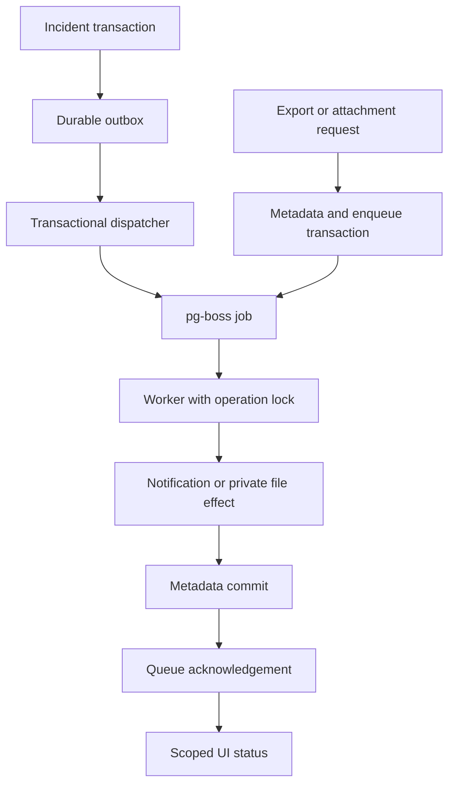

# Phase 4 architecture and contracts

## Two durable enqueue boundaries

Incident creation/action stores a domain_outbox row atomically with the incident, activity/comment and metadata audit. Recipients are the reporter and current assignee, captured at that revision; duplicate recipients collapse. A worker dispatcher locks a pending event, creates recipient-specific operations and real pg-boss jobs through the same SQL client, then marks the event dispatched in that transaction. No queue outage silently drops an incident notification. Historical incidents are not backfilled into fabricated events.

Export/upload/removal/retry requests own a SQL transaction. Active membership, scoped incident, snapshot/revision, idempotency and quotas are checked; file/operation metadata, pg-boss send with a transaction Db adapter and request audit commit together. A rolled-back request leaves no job or file metadata. Jobs carry only an operation UUID; bounded content stays in application storage, never queue credentials or caller-controlled paths.

## Idempotency and recovery

Request keys are unique per workspace/user, hashed against kind/incident/input. A matching repeated request returns its original operation; different input returns 409. A current revision is required for a new export. The snapshot is fixed before enqueue, so later edits cannot silently change the exported revision. Export includes the incident plus newest 50 activity entries and explicitly labels that bound.

Effects lock the operation row. Completed/cancelled/failed operations are no-ops on redelivery; notification rows also enforce recipient/event uniqueness. Successful effect metadata and completion audit commit together before queue acknowledgement. A crash in that gap may deliver again but cannot create another logical effect. Queue delivery itself is not asserted to be exactly once.

File effects cannot share a transaction with the filesystem. A generated UUID key, expected size/hash and private-file metadata identify one object. A 0600 temporary file is written/fsynced, atomically hard-linked without overwriting an existing target, verified on replay, and the containing directory fsynced. Then the SQL metadata becomes ready. Failure after the file exists but before DB commit leaves a known pending object that the next attempt verifies. Hash mismatch is a visible failure, never an overwrite. Removal first sets deleting, revoking download, then idempotently unlinks/fsyncs and commits deleted metadata. Failed pending work may be discarded via the same cleanup route. Deleted-file payloads are scrubbed during reconciliation.

The two crash-point tests use controlled thrown errors and deliberately omitted acknowledgement followed by real pg-boss fail/retry, not an actual killed process or power-loss experiment. Local filesystems support the exercised hard-link/fsync behavior; other volumes require deployment verification.

## Retry and failure policy

One queue submission permits 2 retries (3 attempts), exponential retry delay starting at 1 second, and 30 seconds active expiry. A job stays eligible for 1 day; completed queue records retain 7 days. On exhausted/cancelled/missing-expired jobs, reconciliation makes the application failure explicit with safe codes/timeline. API operation reads also reconcile; no running poller is required to notice a persisted final queue failure. Membership is rechecked at effect execution; revoked requesters cancel publication, suppress notifications and remove pending output where appropriate. Cleanup privileges are rechecked.

After repair, only the requesting user may manually retry a failed operation, with at most 2 manual resubmissions. The same logical operation/file key is retained; attempt history is cumulative. Completed/deleted/cancelled work cannot be silently retried. Operator role loss during cleanup can exhaust retries and leave deleting metadata; the owner/operator must restore authorization and explicitly repair/retry. No indefinite loop.

The worker dispatches at most 10 outbox events per pass and polls every second. FIFO outbox selection may let a full workspace hold up later events; durability is preserved, fairness is future work. Graceful stop halts dispatch/polling before ending the database pool. An hourly sweep removes only recognized UUID blob/temp names older than 24 hours which are not live/pending DB objects. Known objects, unexpected operator filenames and symlink targets are preserved. A UUID-named stale symlink itself can be unlinked without following its target.

## Security and API matrix

| Resource/action | Permission | Bound |
|---|---|---|
| Request export/upload | Active incident workspace member | 20 pending user requests; 100 workspace operations |
| Export download | Active requesting user in workspace | Captured revision, max 256 KiB |
| Attachment download | Active workspace member | .txt UTF-8, 1–16 KiB, no NUL |
| File removal | Owner or workspace lead/admin | Current work must finish/fail; deletion hides download immediately |
| Operation status/history/retry | Active requester only | 1–50 items; scoped UUID boundary, exact SQL timestamp precision; latest 20 timeline events |
| Notifications/read receipt | Active recipient only | 1–50 items; scoped UUID boundary, exact SQL timestamp precision |
| Worker effect | Revalidated active requester | Queue data strict UUID-only schema |

File metadata has composite scope foreign keys to incident/workspace; operations and notifications also bind file/event scope. Live file limits: 20 attachments per incident, 100 files and 8 MiB per workspace. Pending/failed files consume quota until cleaned. Filename policy accepts conservative ASCII `.txt` names and rejects separators, double dots, control characters and Windows reserved basenames. Base64 must be canonical, decode within the byte limit and be valid UTF-8. Accepted markup remains text; there is no parser, rich rendering or scanner.

The server never constructs a filesystem path from the uploaded name. Only validated generated UUIDs become flat private object keys. The root is absolute, 0700, outside the static web root; symlink roots are rejected, reads use O_NOFOLLOW, and object size/hash are checked on download. Files are 0600, outside static serving. Responses force attachment/nosniff/no-store. OS administrators and privileged DB operators remain trusted; this is not hostile-host protection or an independent tamper-proof store.

API and worker share the same database and private mounted directory. DATABASE_URL/JOB_DATABASE_URL remain environment-only; neither job payload nor HTTP metadata exposes them. Local bootstrap uses the existing broad migration/owner role to install/check pg-boss schema 45 and create the queue. A separate-process PGlite smoke attempt failed with Connection terminated unexpectedly at worker queue startup; see phase4-worker-deployment-gate.json. Separate worker credentials are configurable, but production least-privilege roles/DDL bootstrap, multi-process/multi-worker locking and PostgreSQL 18.6 deployment are unverified release gates. No Redis, public bucket, external notification channel or AI.

## UI and retained behavior

Open files exposes snapshot export, text upload, scoped download, operation timeline/retry, removal and recent operations after reload. Notifications refresh and mark read. The browser client sends JSON Content-Type only when a body exists, so empty DELETE requests are valid. Critical checks remain server-side; client file type/size hints are convenience only. Existing incident lifecycle and knowledge publication workflows remain default and independent of worker uptime.

Notification UI currently shows state/revision; the scoped API also exposes incident IDs. Contextual deep links and further UI polish remain future work. Permanent operation/audit metadata retention and outbox retention policies also remain debt; file/payload quotas and cleanup do not establish a database-wide retention bound.
