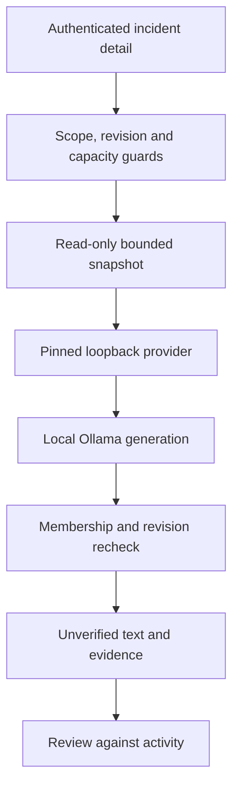

# Phase 6 — Local draft assistance

The model is a function that produces text, not an authority or tool executor. The application owns every permission, fixed URL/path, digest check, input/output budget and stop condition. The generated draft never changes incident state/content. There is no model-selected tool or persistence action.

| Boundary | Enforced behavior |
|---|---|
| Feature/config | AI_ENABLED=false default; enabling requires nonproduction LAB_MODE and full pinned digest. Capability reflects server flag, not provider health or quality. READ_ONLY also blocks summary computation. |
| Caller/object | Session plus active workspace membership before compute; scoped incident/current revision; post-inference membership/revision recheck prevents delayed leaks/stale delivery. |
| Evidence/context | Consistent read-only snapshot, incident ID/title/state/revision and latest 20 activity IDs/transitions/notes. Notes capped at 300 characters; visible omission flags. No credentials/session headers/account records/attachments are fetched. Selected credential patterns/auth secret are redacted; arbitrary prose may still contain unknown secrets, so only synthetic data is supported. |
| Local provider | HTTP origin must be literal 127.0.0.1 without credentials/path/query; only fixed version/tags/generate paths, redirects rejected. Fixed local Qwen tag allowlist, installed GGUF/full digest match before generation. No cloud model tags, provider chosen by client or hosted fallback. |
| Resources | Single in-flight request, no queue/retries, max 12,000 prompt characters, 32 KiB response bytes, 8,000 generated characters, context 4,096, prediction 256 tokens, temperature 0/seed 42/think false, keep_alive 0. Configurable 50 ms–120 s provider deadline (30 s default); browser deadline 125 s for this endpoint. Three summary requests/minute per direct peer. |
| Result/UI | Text is escaped; reviewRequired and source event IDs/model/runtime/prompt/context hashes/usage accompany it. Context/output truncation is visible; late revision changes discard it. Refresh/retry is deliberate. Model citation correctness/truth is not automatically established. |
| Observability | Safe request errors and metadata-only structured success logs. Pilot JSON exports bounded synthetic outputs with fixture version/hash, actual runtime/model hashes, repetitions, usage and latency. No hidden reasoning transcript or automatic quality/release verdict. |

AI disabled/outage preserves conventional incident/keyword workflows. The default provider does not contact Ollama while AI is off. Its configuration points at a local daemon owned by the operator; OLLAMA_NO_CLOUD=1 is enforced on the owned experimental runtime and observed in logs. This is not a system-wide egress firewall or protection from a malicious local operator/daemon. Production enablement is deliberately rejected for this synthetic lab.

## Test and experiment separation

- Unit tests use real local HTTP fixture servers for manifest/options/budget/deadline/redirect behavior; they are not live inference.
- API tests use real SQL plus an explicit provider fixture for no-mutation, scope/stale checks, timeout recovery, post-inference revocation/revision and single capacity. Model text is not their quality oracle.
- Browser acceptance uses an explicit test-only provider fixture, verifies literal output, visible review warning, controlled outage and draft invalidation after a comment; axe checks that selected state.
- Live pilot performs 24 actual generations (2 models × 4 cases × 3 repetitions): ordinary timeline, malicious-note hallucination, human failure triage and human change-risk analysis.
- Live API smoke uses actual Ollama through the authenticated summary route, stops its owned daemon, verifies 503 plus continuing incident reads, restarts it and generates again without incident revision change.

Expired-session fixture now uses now() AT TIME ZONE UTC when writing the auth schema's UTC timestamp-without-zone field. Resumed environment DB timezone made implicit casting create a future value. Authentication rules and the expected 401 are unchanged; this fixes the fixture convention, not a bypass/retry.

Inherited native PostgreSQL/worker/roles/volume/crash/restore and remote CI release gates remain open. Desktop GPU/VRAM/driver, planned 8B benchmark, human semantic review and learner demonstration remain pending. M1/M2/full Phase 6 completion is not claimed.
