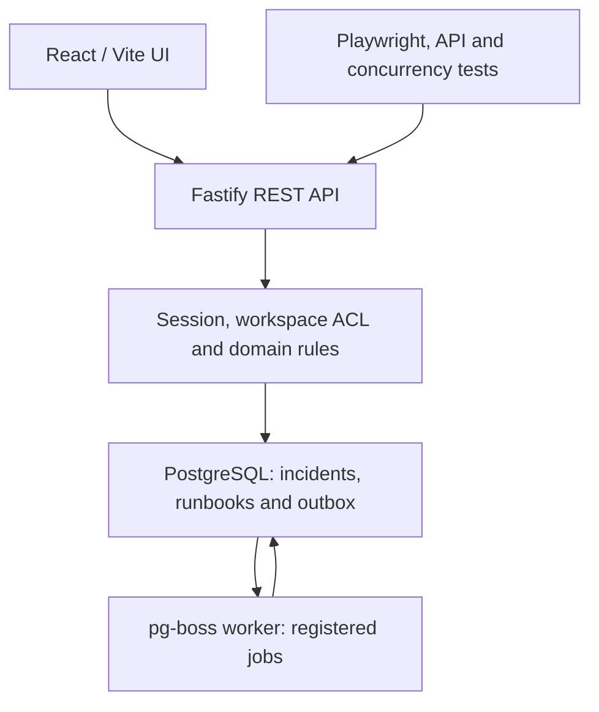
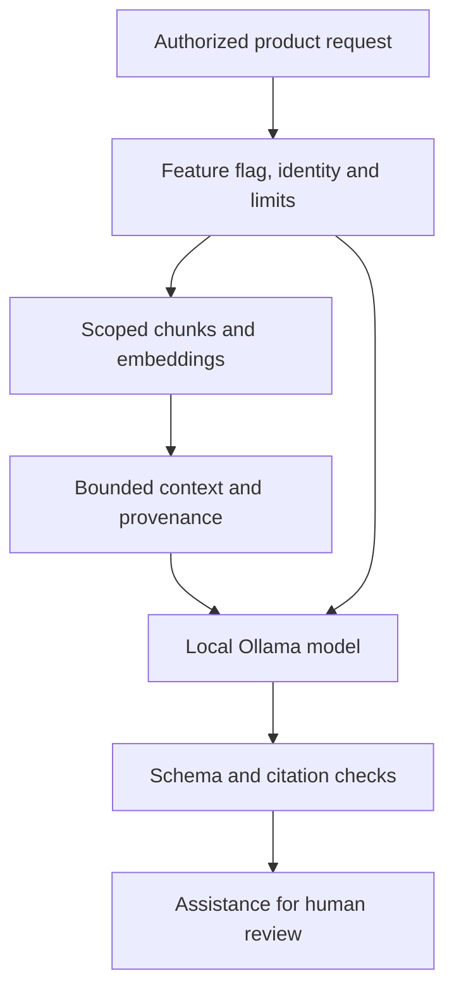
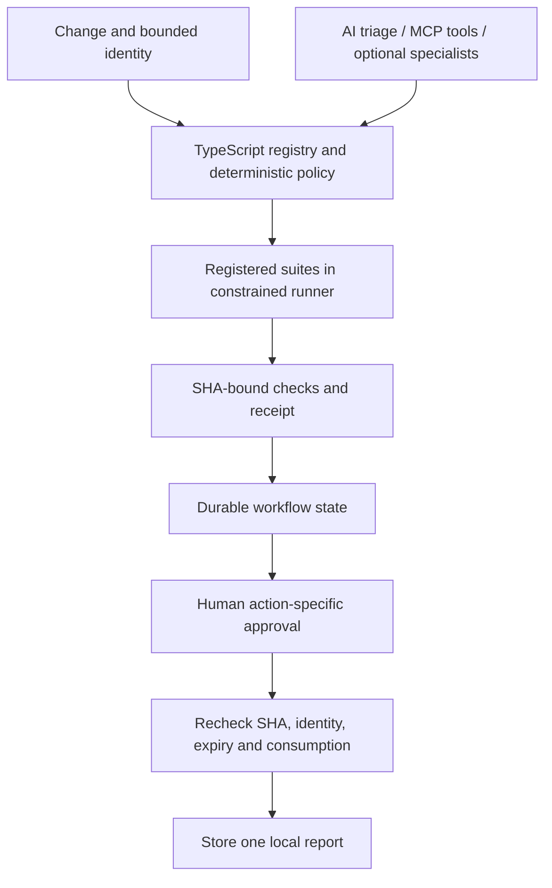
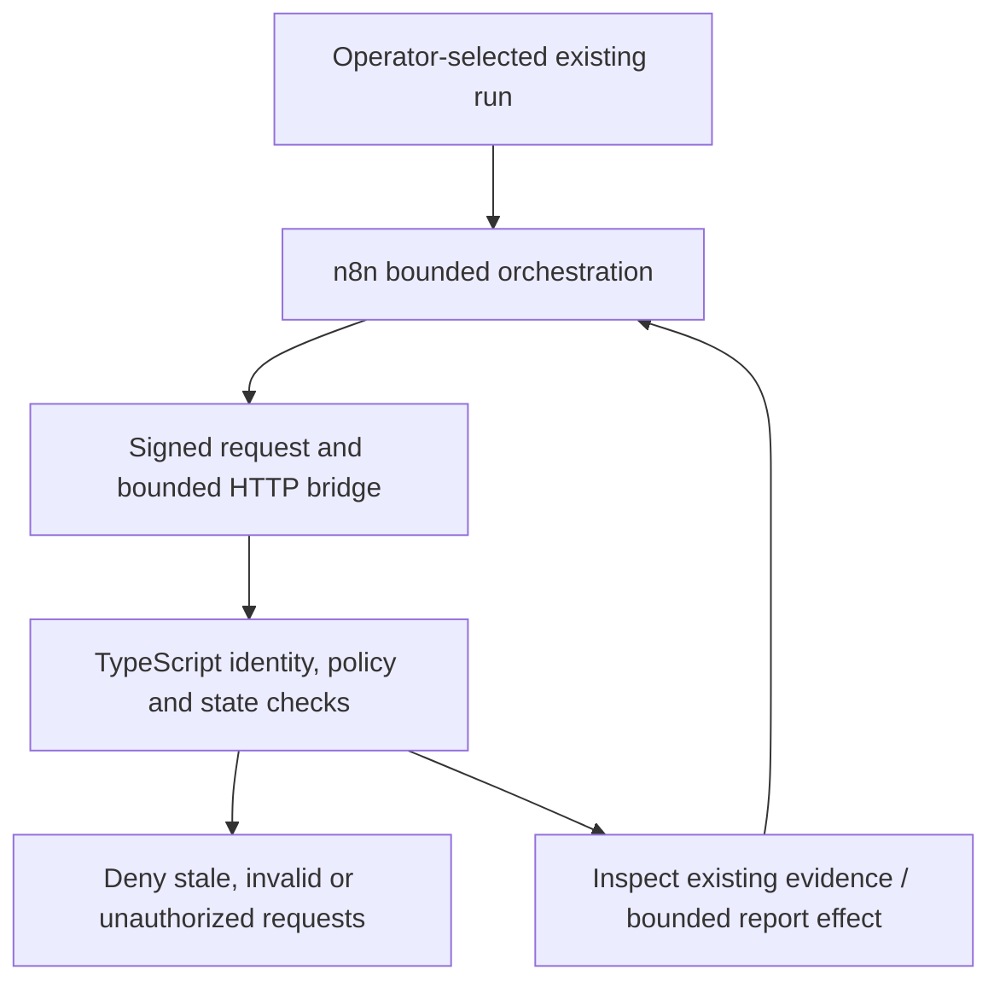
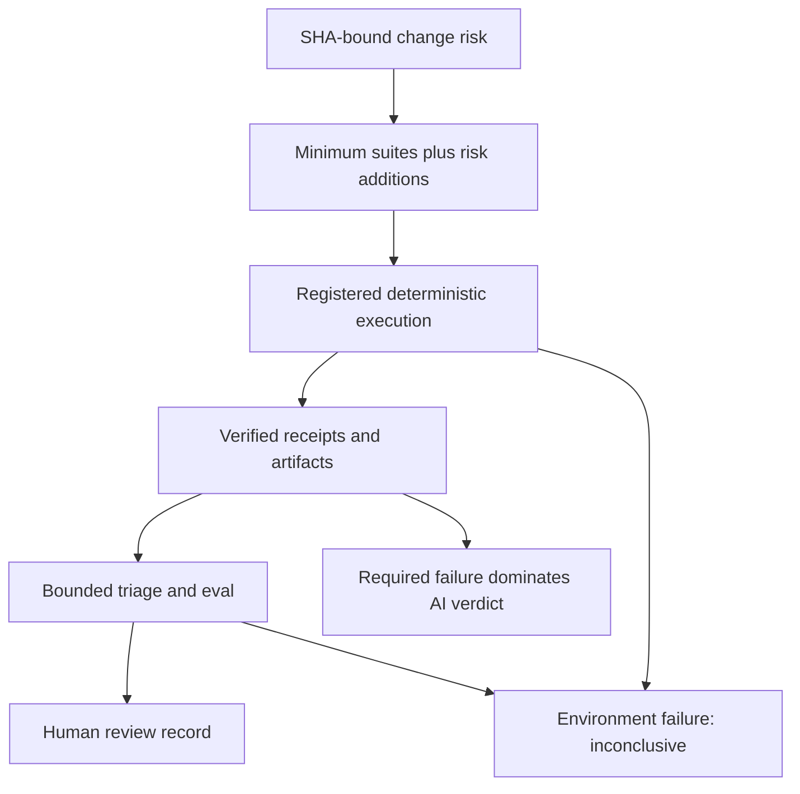

# Architecture and authority

[Portfolio entry point](../../README.md) · [Claims](claims.md) · [Detailed M4 flows](../m4-architecture.md)

## Product path

The modular monolith keeps policy close to domain transactions. The worker is a distinct process, not a second policy authority. Trusted registered test code can exercise synthetic product mutations; model output cannot perform operational incident mutation.

## Local AI / RAG path

Retrieval integrity and citation validation are mechanical checks, not proof of answer truth. Product semantic search is distinct from experimental QA retrieval, which was rejected for default adoption. No external live model run is needed to read the accepted observations.

## QA control plane

Failed required checks cannot be approved. Approval is bound to the action, receipt, SHA, identity and expiry, and is one-time consumable. The check-to-effect expiry test covers the TOCTOU window. Nothing in this diagram authorizes merge or release. Phase 19 artifact review is a review record, not this approval or a side effect.

## n8n → TypeScript boundary

The export contains credential references, not credential values. A signed message does not bypass required checks. n8n Community/self-hosted is not an OS sandbox. Application egress denial does not establish process isolation or exactly-once transport.

## Phase 19 change-to-evidence path

The accepted smoke ran real registered checks against synthetic change inputs; triage/review were fixture driven. It demonstrated a bounded evidence chain, not live model quality or human understanding. Browser-use and patch-proposal complexity were deferred because no demonstrated gap required them.
