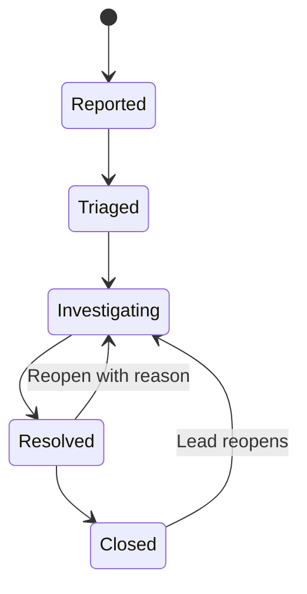
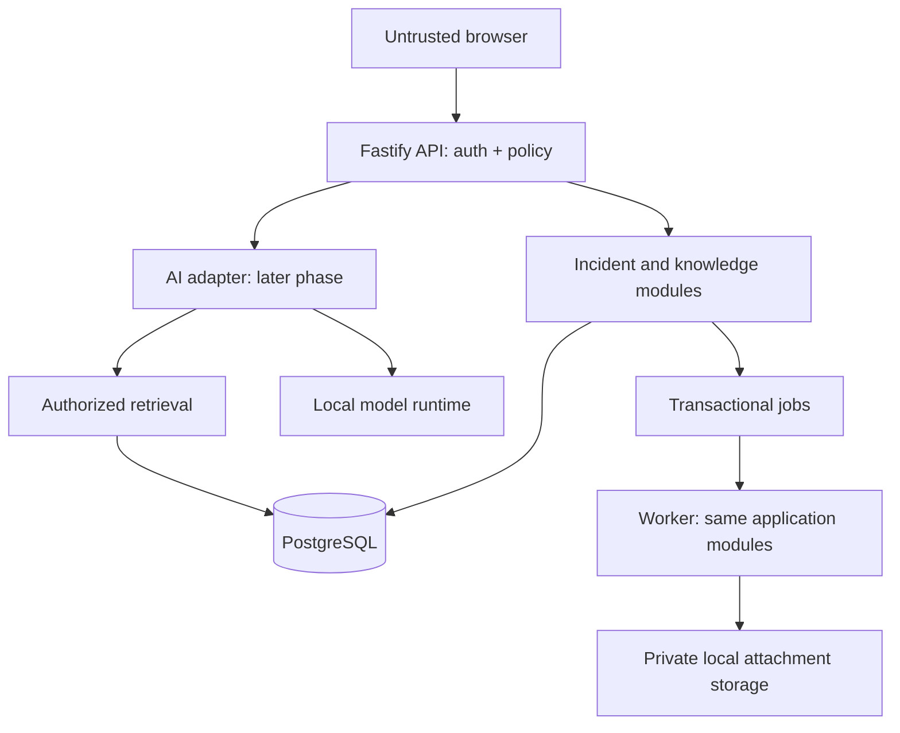
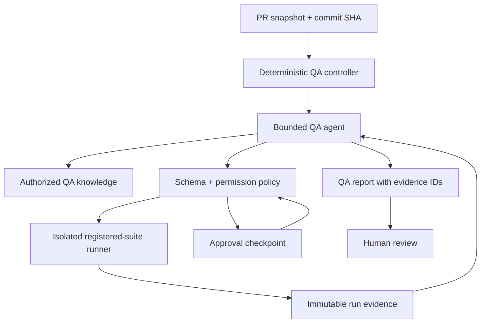
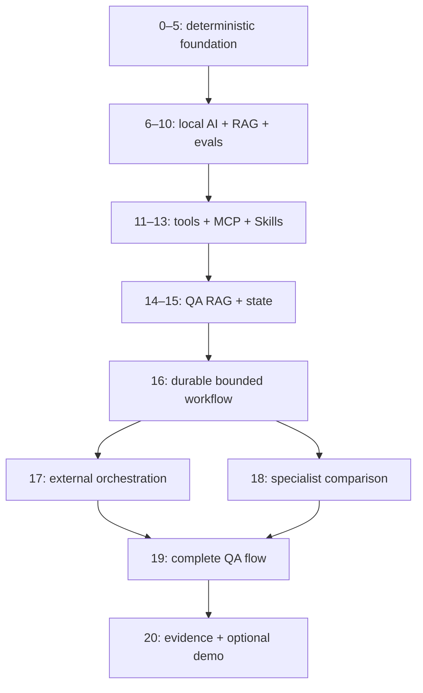

# AI-First App + Agentic QA Lab

## Planning baseline

**Recommended product: OpsLedger — Incident & Runbook Operations.**

Prepared for Víctor Martín Aller. Research date: **2026-10-07**. Technical documentation is in English, as requested. This is a planning deliverable: no application code, repository, dependency installation, infrastructure deployment or model benchmark was performed.

This roadmap is dependency-driven, not calendar-driven. Versions and free tiers are a dated research snapshot, not a promise that they will remain current throughout a long project. Phase 0 must resolve exact package versions, security advisories and compatibility; later phases repeat that check for newly introduced dependencies.

Labels used below:

- **Selected:** architectural choice supported by current documentation and project needs.
- **Provisional:** candidate requiring a compatibility spike or measured local experiment.
- **Deferred:** no dependency or infrastructure until its stated trigger occurs.
- All acceptance targets are **proposed targets**, not observed results.

## Approved Execution and Learning Rules

**Amendment approved: 2026-10-07.** The existing roadmap is the authoritative planning baseline. This amendment changes execution governance and learning gates, not the technical architecture. The current authorization is recorded in the 2026-10-08 milestone amendment below.

### Architectural direction remains approved

Preserve OpsLedger, modular monolith, deterministic product before AI, React + Vite, Fastify + TypeScript, PostgreSQL and pgvector before a separate vector database. Preserve local-first/zero-cost-first inference with Ollama or an equivalent local runtime before paid APIs.

Preserve direct bounded TypeScript loop before an agent framework; direct tools and a transport-neutral registry before MCP; MCP before advanced orchestration; RAG mechanics before QA RAG; single agent before specialists; n8n only in Phase 17 after workflow fundamentals. Security, evals, observability and evidence remain mandatory. No arbitrary shell, unrestricted filesystem or uncontrolled autonomous behavior. AI output never overrides deterministic security/quality gates. Every portfolio claim requires technical evidence.

Change an approved decision only when a future authorized phase produces concrete evidence, with a documented problem, alternatives, trade-offs and ADR. Do not redesign opportunistically or add fashionable technology.

### Six milestone checkpoints

| Milestone | Phases | Independently demonstrable outcome | Stop/review gate |
|---|---|---|---|
| M1 — Production App | 0–5 | Deterministic OpsLedger with professional QE, CI, security, RBAC, concurrency, async behavior, basic observability and architecture documentation | Demonstrate v1 with AI off; review readiness/value of AI Product |
| M2 — AI Product | 6–10 | Local GenAI, structured outputs, embeddings, RAG, grounded answers and AI/adversarial eval evidence | Review measured value and limitations before Agent Foundations |
| M3 — Agent Foundations | 11–13 | Direct loop, bounded tools, registry, MCP and distinct Skills/prompts/resources | Explain and demonstrate contracts/policy before Agentic QA |
| M4 — Agentic QA | 14–16 | QA RAG, context, state/memory, durable workflow, HITL and evidence-backed execution | Review whether advanced orchestration/specialization adds value |
| M5 — Advanced Agentic QA | 17–19 | n8n workflow, measured specialist comparison and bounded end-to-end QA | Review evidence, limitations and release readiness |
| M6 — Portfolio Release | 20 | Publicly understandable evidence package; optional viable free-tier demo | Review truthful claims, reproduction and any future scope |

These are learning checkpoints, not deadlines. At each milestone end, finish validation/evidence and the learning gate, produce a demonstrable package, then **stop**. Review whether the next milestone remains justified using outcomes, understanding, risks, measured benefits and remaining debt. Record continue/defer/simplify as a recommendation; user authorization for a later assignment is still required. No automatic transition.

Phases 5, 10, 13, 16 and 19 are valuable portfolio endpoints independently of Phase 20. Success does not require finishing all **21 phases numbered 0–20**. Later work must not weaken an earlier milestone.

### Authorized milestone execution

**Governance amendment approved: 2026-10-08.** This amendment supersedes “one phase per Work assignment” and per-phase human Teach-Back gates. All individual phase scopes, engineering DoD, tests/evals, evidence, security requirements and architecture boundaries remain in force.

Work may progress autonomously through consecutive phases inside the explicitly authorized milestone. Finish each phase's engineering DoD, implementation, security review, validation, evidence, documentation and phase report before starting the next. Preserve phase identity and coherent commits/PR history; do not combine phase scopes.

Stop automatically at the milestone boundary. Never enter the next milestone without explicit user authorization. Stop earlier for a failed required deterministic gate, serious security issue, architecture/product decision requiring human judgment, or unresolved blocker materially affecting the next phase. Resolve ordinary technical problems autonomously.

**Current authorization:** Phase 6 is human-reviewed and closed. Complete Phase 7's remaining engineering/evals, then Phase 8 → Phase 9 → Phase 10. Stop at M2 — AI Product. Phase 11 and M3 are not authorized.

### Consolidated milestone Teach-Back

Generate practical learning material for each phase and accumulate it; do not require separate learner answers at each transition. At milestone closure provide one consolidated checkpoint with approximately 5–8 important questions total, one or two architecture/data-flow explanations, selected educational controlled failures, key security boundaries, 1–2 Senior/Staff interview scenarios and links to evidence.

Never assume learner answers or claim understanding before demonstration. Distinguish engineering validation, accumulated learning materials and milestone learner demonstration pending/completed. Human understanding is evaluated at milestone boundaries.

### Focused human semantic review

Automated datasets, deterministic validation and evals handle repetitive review. Direct human semantic review is required when material: establishing/changing a quality baseline, calibrating an evaluator, evaluating materially different model behavior, judging product value, validating security-sensitive behavior or closing a milestone. Prefer representative sampling over review of every generated output. AI remains untrusted; semantic uncertainty never weakens deterministic gates.

### Desktop Validation Bundle

Perform engineering validation available in Work. Collect checks that genuinely require the user's hardware into one Desktop Validation Bundle at the relevant milestone end whenever technically possible. Interrupt earlier only when hardware-specific results are true prerequisites for the following phase and cannot reasonably be deferred. Do not ask the user to repeat deterministic tests already adequately proven by Work/CI without a specific reason.

Maintain reproducible local setup throughout development. The integrated milestone and final product must remain demonstrable on the user's desktop. For M2, consolidate local-model, structured-output, embedding, retrieval, RAG and eval validation after Phase 10.

### M2 milestone delivery

At the Phase 10 boundary deliver the consolidated M2 engineering report, Teach-Back, important human-review samples, one Desktop Validation Bundle, current architecture diagram, security/eval summary, outstanding debt/limitations and a recommendation on M3. Stop before Phase 11 even if all automated checks pass.

### Fundamentals before abstractions

Explain and, when practical, build each mechanism before its framework:
 
- Agent framework: model/tool loop, bounded context, schemas, executor policy and stop conditions.
- MCP: direct tool call, transport-neutral registry, schemas and permissions.
- RAG frameworks: ingestion, chunks, embeddings, retrieval, context and generation separately.
- Memory: durable state, history, provenance, review and expiry.
- n8n: deterministic workflow, retry, idempotency, state, tool execution, approval and orchestration semantics.

Maintain distinct implementations/explanations of instructions, prompts, structured outputs, function tools, registry, MCP tools/resources/prompts, Skills, RAG, embeddings, context, memory, state, workflows, agents, handoffs, multi-agent systems, guardrails, HITL, evals and tracing. **Skills are not automatically an MCP core primitive.** A framework must not conceal where policy, state and evidence actually live.

### Deterministic quality and failure-driven learning

Playwright remains primary deterministic browser/API automation for known testable behavior. Browser/computer-use agents require a specific later learning objective or capability gap; their probabilistic exploration is reported separately from deterministic regression evidence.

Preserve risk-based layers, independent assertions, API/DB/concurrency/security coverage, meaningful failure evidence and no E2E dominance. No retry-to-green. AI triage is a hypothesis; inconclusive is distinct from pass. Required deterministic checks remain authoritative.

Use existing phase failures deliberately: malformed output, hallucination, retrieval miss/unauthorized retrieval, stale or poisoned documents, indirect injection, wrong/forbidden tool, provider outage, tool timeout, approval bypass/replay/staleness, memory poisoning, duplicate async processing, broken workflow recovery and inconclusive evidence. Record what was actually reproduced, detected and recovered. Include selected failure artifacts in portfolio evidence.

### Advanced technology adoption limits

Phase 18 is an experiment, not a commitment to multi-agent adoption. Compare correctness, eval score, context quality, latency, cost/resource usage, failure modes, security complexity, handoff/context loss and operational complexity against the same single-agent baseline. A documented rejection for insufficient meaningful benefit is a successful phase.

n8n stays in Phase 17. Explain its concrete contribution against TypeScript application logic and the agent runtime. Business rules and authorization remain in TypeScript unless strong later evidence justifies a reviewed change.

### Required phase completion report

Use this structure at the end of every executed phase:

| Field | Required content |
|---|---|
| Completed | Implemented scope, and any incomplete items |
| Architecture | Important decisions and why |
| Validation | Exact commands/tests/checks/evals actually run, results and skipped/blocked checks |
| Security | Threats and enforcing boundaries addressed |
| Evidence | Links/IDs for real artifacts |
| Trade-offs / Debt | Known limitations and deliberate deferrals |
| Learning | New concept and practical implications |
| Learning materials | Accumulated phase concepts and evidence; milestone Teach-Back status, without a per-phase human gate |
| Interview Defense | Most important decision to defend |
| Next Phase | Continue only inside the explicitly authorized milestone after engineering DoD passes; stop at milestone end |

Do not declare engineering completion when required engineering criteria remain unmet. Report actual validation and pending milestone human/desktop criteria accurately. Accumulated learning and genuinely deferrable desktop checks do not create routine per-phase human gates.

### Corporate delivery

For every meaningful authorized phase: semantic branch → implementation → tests/evals → security review → documentation → reviewable commits/PR → validation evidence. Consolidate human review at the milestone gate, with earlier material exceptions above. Prefer coherent commits and reviewable PRs; several PRs may belong to one phase. Keep phase identity visible in history/PR descriptions. Never modify main directly or merge without explicit authorization.

## A. Executive Recommendation

Build a local-first incident management platform for a small internal operations team. Users report incidents, responders investigate, incident leads coordinate resolution, and knowledge editors maintain versioned runbooks. The application preserves evidence and history. Later, AI helps retrieve relevant runbooks, summarize incident timelines and propose grounded next steps.

Build a separate QA control plane in the same future monorepo. It evolves from deterministic quality checks to an agent that can inspect a bounded change snapshot, select registered suites, run them in an isolated environment and produce an evidence-backed report. It cannot merge, deploy, modify production records or execute arbitrary commands.

This gives the same domain two meaningful AI surfaces: an operational copilot inside the product and a QA agent outside it. They share contracts and infrastructure where useful, but have different identities, permissions, datasets and evaluation criteria.

Start with a modular monolith, a React SPA, Fastify REST API and PostgreSQL. Add pgvector to the existing database for RAG. Add Ollama only after the deterministic product milestone. Learn a small agent loop directly before adopting a runtime. Learn direct tools before MCP. Add n8n as an external orchestrator, and specialists only if a measured comparison justifies them.

The important portfolio claim is: “I built and evaluated a bounded QA system with reproducible execution evidence and measured AI limitations.” A long list of dependencies is not evidence.

## B. Product Candidates

Scores are architectural judgment on a 1–5 scale, not market research. All criteria have equal weight to make the decision transparent.

| Criterion | OpsLedger: incidents + runbooks | ServiceDesk: support + knowledge | FlowOps: approvals + operations workflows |
|---|---:|---:|---:|
| AI learning value | 5 | 5 | 4 |
| QA surface richness | 5 | 5 | 5 |
| Agentic QA suitability | 5 | 5 | 4 |
| Natural RAG use case | 5 | 5 | 3 |
| Useful AI product features | 5 | 5 | 4 |
| Architecture learning value | 5 | 4 | 5 |
| Portfolio evidence potential | 5 | 4 | 4 |
| Solo feasibility with AI assistance | 4 | 4 | 3 |
| Local/free operation | 5 | 5 | 5 |
| Incremental evolution | 5 | 5 | 4 |
| **Total / 50** | **49** | **47** | **41** |

**OpsLedger:** coherent state machine, concurrency, historical evidence and runbooks. Main risk: accidentally building a full monitoring/ITSM suite.

**ServiceDesk:** equally credible RAG and authorization surfaces; risks spending time on email integrations, customer communication and SLA configuration.

**FlowOps:** strong approval and audit surfaces; a generic workflow builder expands scope and makes the domain less concrete.

Select **OpsLedger**. Keep support tickets and configurable workflow engines out of the initial scope. Reconsider only if real usage shows the incident domain is uninteresting; the architecture does not require an enterprise SaaS.

## C. Final Product Definition

### Users and scope

A small internal operations team manages fictional services. Use synthetic incidents and documents exclusively. Two seeded workspaces provide realistic isolation tests without billing, subscriptions or enterprise tenant provisioning.

| Persona | Responsibilities | Allowed actions |
|---|---|---|
| Reporter | Reports symptoms and follows progress | Create incidents; view/comment on permitted incidents |
| Responder | Investigates assigned services | Triage, assign, investigate, propose resolution |
| Incident lead | Coordinates high-impact incidents | Change severity, resolve, reopen, close |
| Knowledge editor | Maintains operational guidance | Draft/version/publish runbooks |
| Workspace admin | Manages memberships and settings | Grant roles within own workspace; revoke access |
| QA service principal | Executes approved lab checks | Read synthetic snapshots and run registered suites only |

Roles combine with workspace membership and object visibility. A role alone never authorizes cross-workspace access. Reporter access is limited to their own incidents unless workspace visibility permits more.

### Workflows

1. Report symptoms against a service; validate severity, title and description.
2. Triage and assign; record actor, transition and timestamp.
3. Investigate with comments and attachments; preserve concurrent edits safely.
4. Resolve with a mandatory resolution summary; close only after resolution.
5. Reopen a resolved incident with a reason; closed incidents require a lead action to reopen.
6. Draft and publish a runbook; link an incident resolution to a proposed knowledge update.
7. Produce async notifications and an incident export.
8. Later: retrieve runbooks, generate a cited answer and accept/edit/reject an AI suggestion.

Transition rules live in the domain service and API, not in UI button visibility. Use optimistic concurrency with a revision number; stale writes return a conflict instead of silently overwriting. Store timestamps in UTC; display local time. Start SLA semantics as elapsed time rather than business calendars.

### Entities

User, Session, Workspace, Membership, Service, Incident, IncidentRevision, Comment, Attachment, ActivityEvent, AuditEvent, Runbook, RunbookVersion, Notification, Job. Later: DocumentChunk, EmbeddingManifest, RetrievalRun, Suggestion, ModelRun, QARun, EvidenceArtifact, Approval and EvaluationResult.

Audit events record actor, workspace, action, object, safe change summary and correlation ID. They are append-only through normal application permissions; this is not a claim of cryptographic tamper resistance against a database administrator.

### Incremental boundaries

**First slice:** authenticated user creates, lists and opens an incident in one permitted workspace.

**Deterministic v1:** RBAC, full incident lifecycle, search, comments, audit, versioned runbooks, bounded attachments, notifications, reliable jobs and observable failures.

**AI v1:** cited runbook answers and editable incident summaries; no autonomous incident mutation.

**QA agent v1:** change analysis, bounded suite selection/execution and evidence report; generated tests remain proposals.

**Excluded:** billing, real paging, monitoring ingestion, arbitrary custom workflows, mobile app, multi-region infrastructure, autonomous remediation and production shell access.

## D. Architecture

API and worker are two process entry points for one application, not independently owned microservices. API modules are identity/access, incidents, knowledge, files and notifications. Shared packages contain explicit contracts and pure domain rules; avoid generic repositories, abstract service hierarchies and wrappers around every dependency.

Future monorepo layout: apps/web, apps/api, apps/worker, apps/qa-lab; packages/contracts, packages/domain and packages/qa-tools only when actual consumers exist; tests, evals, docs and infra. One repository allows a PR to change product behavior, tests and eval fixtures together.

The SPA communicates through versioned REST endpoints. Prefer same-origin delivery for the built SPA and API to simplify cookies and deployment. Vite proxies API requests during development. No SSR requirement exists for an internal operations tool.

### Trust boundaries

| Boundary | Enforcement |
|---|---|
| Browser → API | Session, input schemas, origin/CSRF controls, rate limits |
| API → domain/data | Workspace/object authorization, constraints, transactions |
| File → parser | Allowlisted types/size, private storage, timeout and no network |
| Retrieval → model | Authorized/versioned chunks; documents treated as data |
| Model → tools | Schema + deterministic policy before any execution |
| QA agent → runner | Registered suite IDs, fixed trusted entry points, isolation |
| PR content → CI | No secrets for untrusted forks; constrained permissions |
| Approval → resumed action | Actor authorization, immutable argument hash, expiry |
| Trace → viewer/export | Redaction, access controls and retention |

Testability seams: clock, IDs, model provider, notification sink, job scheduling and fault injection. Use real PostgreSQL integration tests. Production configuration must reject lab-only fault/reset routes; these must not be exposed merely behind a guessable URL or client flag.

## E. Technology Decision Matrix

Cost below means software/license cost for personal local learning; hardware, electricity, commercial license conditions and hosted usage are separate.

| Area | Choice/status | Alternatives and reason | Cost/local | Maturity/learning/risk |
|---|---|---|---|---|
| Runtime | Node.js 24 LTS; TS strict | Node 26 Current gains little for this lab | $0; native | Stable LTS; pin patch; do not use EOL Node |
| UI | React 19 + Vite 8; selected | Next.js introduces SSR/server component surfaces not needed; Vue is viable but adds different conventions | $0; native | Mature; focus on state/error/accessibility rather than frontend depth |
| API | Fastify 5 modular monolith | NestJS adds framework ceremony; Express requires more conventions | $0; native | Schemas and injection testing; plugin compatibility needs spike |
| Data | PostgreSQL 18 supported line | SQLite is simpler but reduces concurrency/vector parity; no second DB | $0; Compose | Transactions, indexing, migrations; operational responsibility |
| Query | Drizzle; provisional stable release | Prisma is viable; Kysely + manual SQL is fallback if compatible Drizzle requires prerelease | $0; native | SQL visibility; inspect migrations, never blindly push shared schema |
| Validation | Zod 4 + reviewed JSON Schema | TypeBox has official Fastify provider; avoid two independent schemas for one DTO | $0; native | Cross-layer reuse; Zod conversion/provider compatibility is a Phase 0 gate |
| Auth | Better Auth; provisional | Managed auth adds network/cost; own password/session implementation adds security burden | $0 core; local | Documented Fastify integration; own domain authorization still required |
| API contract | REST + OpenAPI | GraphQL/tRPC unnecessary for these consumers | $0; local | Exposes contracts to tests/MCP; runtime and published schema must agree |
| Workspace | npm workspaces | No Nx/Turborepo until build time requires it | $0 | Familiar minimal tooling |
| Infrastructure | Docker Compose profiles | Kubernetes unnecessary | $0 engine; local | Reproducibility; Docker Desktop commercial terms must be checked |
| Jobs | pg-boss in async phase | BullMQ adds Redis; hand-written queue hides reliability work | $0; existing Postgres | Transactional enqueue; external effects still need idempotency |
| Attachments | Private filesystem volume + metadata | S3-compatible service later only for storage-adapter exercise | $0; local | Bounded formats; no arbitrary path or public uploads |
| Logs | Fastify/Pino structured logs | No custom logger framework | $0 | Redact cookies/tokens/content |
| Tracing | OpenTelemetry; later Langfuse profile | Jaeger useful for app tracing; Langfuse useful for prompt/eval inspection | $0 self-hosted core | Additional stack has real RAM/storage cost |
| Feature flags | Typed server-side config first | Unleash only for targeting/rollout lesson | $0 | Server policy remains authoritative |
| Cache | None initially | Redis only after measured need | $0 | Fewer state consistency problems |
| Inference | Ollama selected | LM Studio for manual inspection; llama.cpp for deeper tuning; vLLM deferred | $0 runtime; local | Capability differs by model and quantization |
| Vectors | pgvector selected | Qdrant only for a later measured database comparison | $0; existing DB | Exact search baseline before approximate indexes |
| Agent | Direct bounded TS loop first | Later compare OpenAI Agents SDK with LangGraph JS | $0 SDK; model cost separate | Do not adopt both frameworks in production path |
| MCP | Official TS SDK v2 | Custom protocol implementation unnecessary | $0; stdio first | New stable line; consumers may lag latest protocol |
| Evals | Versioned TS fixtures, then Promptfoo | Ragas/Python not baseline; framework does not define the oracle | $0 local core | Explicit local grader and attacker; disable remote defaults |
| Orchestration | n8n Community, deferred phase | TS for business/policy; agent runtime for bounded dynamic reasoning | $0 internal self-hosted | Sustainable Use license is not unrestricted OSI open source |
| Tests | Playwright UI/API; node:test unit/integration | Vitest only if component/unit ergonomics justify another runner | $0 | Test layer chosen by risk, not runner identity |
| CI | GitHub Actions | Local trusted runner for GPU evals; never untrusted PR GPU jobs | Quota-dependent | Action SHA pins, fork isolation, artifact retention |

### Dated official research ledger

These are short factual findings; the architectural choices elsewhere are our design judgments.

| ID | Verified finding | Official source |
|---|---|---|
| S01 | Node release page lists 24.21.0 as latest LTS and 26.11.0 Current | https://nodejs.org/en/blog/release |
| S02 | React documentation lists 19.3; Vite lists supported 8.3 line and website 8.3.1 | https://react.dev/versions ; https://vite.dev/releases |
| S03 | Fastify docs identify latest 5.12.5; schemas are trusted application code; Zod provider is third-party | https://fastify.dev/docs/latest/Reference/TypeScript/ ; https://fastify.dev/docs/v5.5.x/Reference/Validation-and-Serialization/ |
| S04 | PostgreSQL versioning page lists 18.6 supported; new major release status must be rechecked | https://www.postgresql.org/support/versioning/ |
| S05 | Drizzle supports generated SQL migrations and migration application | https://orm.drizzle.team/docs/migrations |
| S06 | Better Auth documents Fastify integration and session/origin security | https://better-auth.com/docs/integrations/fastify ; https://better-auth.com/docs/reference/security |
| S07 | Playwright release notes currently begin with 1.63 | https://playwright.dev/docs/release-notes |
| S08 | MCP 2026-07-28 is released; TS SDK v2 is stable with separate server/client packages | https://blog.modelcontextprotocol.io/posts/2026-07-28/ ; https://ts.sdk.modelcontextprotocol.io/v2/ |
| S09 | Agent Skills is a SKILL.md directory format; allowed-tools metadata is experimental | https://github.com/agentskills/agentskills/blob/main/docs/specification.mdx |
| S10 | Ollama documents tool calls, schema outputs and /api/embed | https://github.com/ollama/ollama/tree/main/docs/capabilities |
| S11 | Qwen3 8B Q4 is listed at 5.2 GB; 14B at 9.3 GB; newer Qwen3.5 includes 9B candidates | https://ollama.com/library/qwen3 ; https://ollama.com/library/qwen3.5 |
| S12 | LM Studio offers a localhost server and compatibility APIs | https://lmstudio.ai/docs/developer/core/server |
| S13 | pgvector supports exact and approximate search; approximate filtering can reduce returned results | https://github.com/pgvector/pgvector |
| S14 | pg-boss uses PostgreSQL queues and supports transactional enqueue and retries | https://github.com/timgit/pg-boss/blob/master/docs/index.md |
| S15 | Agents SDK documents approval interruptions and tracing; tracing has server defaults | https://openai.github.io/openai-agents-js/guides/human-in-the-loop/ ; https://openai.github.io/openai-agents-js/guides/tracing/ |
| S16 | LangGraph JS documents graph state/checkpointing and interrupts | https://docs.langchain.com/oss/javascript/langgraph/thinking-in-langgraph |
| S17 | Promptfoo supports Ollama; red-team defaults may contact hosted generation/grading | https://www.promptfoo.dev/docs/providers/ollama/ ; https://www.promptfoo.dev/docs/red-team/configuration/ |
| S18 | Langfuse core self-hosting is MIT; Compose includes multiple backing services | https://langfuse.com/resources/engineering/clarifications |
| S19 | OTel GenAI semantic conventions remain Development | https://github.com/open-telemetry/semantic-conventions-genai/blob/main/docs/gen-ai/README.md |
| S20 | n8n Community is free self-hosted with excluded enterprise features; licensing limits apply | https://github.com/n8n-io/n8n-docs/blob/main/docs/deploy/host-n8n/community-edition-features.md ; https://docs.n8n.io/sustainable-use-license |
| S21 | OWASP lists prompt injection, excessive agency and vector/embedding risks | https://genai.owasp.org/llm-top-10/ |
| S22 | Render free web services have resource/idle limits; Neon announced 1 GB per free project Oct 2 | https://render.com/docs/free ; https://neon.com/blog/neon-free-plan-1-gb-per-project |
| S23 | Docker Compose manages a multi-container environment | https://docs.docker.com/compose/ |

Do not invent exact patches for packages whose release number was not verified. Before installation record package version, engine requirement, license, advisory status, source link and compatibility test in a dependency ADR. Pin dependencies, lockfile, container digests, browser versions and model digest; upgrades are reviewed changes.

## F. Deterministic Quality Architecture

Start from domain risks and assertions; avoid a ceremonial test layer for every noun.

| Risk | Primary check | Additional evidence |
|---|---|---|
| Invalid transition or missing resolution | Pure domain unit tests and API negatives | Transition matrix |
| Cross-workspace/object access | API integration matrix with real sessions | Denial audit and no-data-leak assertion |
| Lost update | Concurrent integration requests with revisions | Conflict response and preserved history |
| Partial audit/job write | Transaction rollback integration | DB invariants |
| Search pagination defects | API with stable tie-breakers | Dataset and query plan |
| Cookie/session defects | API plus browser sign-in/revocation | Redacted request trace |
| UI critical path | Small independent Playwright E2E set | Browser trace/screenshots |
| Async duplicate effect | Worker crash/retry integration | Idempotency ledger and job history |
| Malicious upload | API/parser security fixtures | Rejected file and no filesystem escape |
| Accessibility | axe checks plus manual keyboard review | Focus path/video |
| Visual regressions | A few stable screens in fixed environment | Reviewed baseline diff |
| Performance | Repeatable TS/Node load harness; later justified load tool | Workload, hardware and p95, not unexplained numbers |
| Resilience | DB/model/worker outage injection | Recovery timeline |

Use Playwright request contexts for API acceptance tests; Fastify injection for fast handler integration; node:test for domain and DB integration. Add React component tooling only for meaningful isolated interactive logic. Shared production contracts can validate responses, but include independent expected outcomes so the same wrong schema cannot make producer and consumer agree incorrectly.

API/OpenAPI checks validate status, error envelope and response shape. No consumer-driven contract platform is needed while all clients live in one repository. Model an external MCP client as an independent contract consumer later.

Data factories create per-test users/workspaces; migrations execute on fresh databases. Never require suite order or reset a shared database while other workers run. Inject a clock for SLA/retry tests. Poll observable state with bounded deadlines; avoid sleeps.

Use built-in Playwright HTML/JUnit/trace outputs initially. Allure is optional only if longitudinal reporting requires it. Retain first-attempt failures; retries diagnose instability rather than erase it. A failed required test cannot become a green gate through an AI explanation.

### CI contract

Future PR flow: semantic branch → lint/strict typecheck/build → domain/API/DB checks → critical E2E → security checks → evidence upload. Full browsers, performance and expensive evals run on their appropriate scheduled/manual lane.

Pin actions to full commit SHAs; default token is read-only. No privileged pull_request_target checkout of untrusted changes. Never execute unreviewed PR code on a developer GPU runner with credentials or host mounts.

Security checks include secret scanning, dependency/lockfile review, container review and a documented reachable-vulnerability policy. A blanket audit failure or blanket ignore is not a useful policy. Exceptions need owner, reason and expiry.

Use protected main and required checks where the GitHub plan supports them. A sole owner cannot provide genuine independent review; use PRs and deliberate self-review without pretending CODEOWNERS creates separation of duties.

## G. AI Product Evolution

| Feature | Before AI | Added value | Boundary |
|---|---|---|---|
| Incident summary | Human reads timeline | Draft concise status/handoff summary | Must reference event IDs; user edits/accepts |
| Semantic knowledge search | Keyword search | Finds semantically related guidance | Retrieval only, independently evaluated |
| Grounded runbook answer | Human reads retrieved docs | Answer with accessible versioned citations | Abstain when context insufficient |
| Suggested resolution | Human links symptoms to runbook | Evidence-backed candidate next steps | Proposal; no execution or state transition |
| Knowledge update draft | Editor writes from resolution | Draft new content with source links | Human publish and versioning required |

Keep AI behind a server-controlled flag. AI disabled/unavailable must preserve incident operations and keyword search. Store accepted suggestions separately from raw generation, including model/prompt/retrieval manifest and human edits.

Example: “What should I check for repeated worker timeouts?” First show ranked runbooks. Later generate a short answer grounded in permitted current versions. If no relevant guidance exists, return insufficient evidence rather than invent an operational command.

Product AI and QA AI use different prompts and eval datasets. Neither may consume unrestricted production-like personal data.

## H. Agentic QA Target Architecture

The controller owns allowed states, mandatory checks, budgets and timeouts. The agent supplies analysis and choices only within that envelope. Minimum checks are derived from versioned deterministic risk rules; an agent can add coverage, not omit required authorization/security checks.

Registered tools might include read_change_snapshot, get_contract, list_suites, run_suite, get_run_evidence, retrieve_qa_knowledge and propose_test_patch. Tools accept structured identifiers, not command strings, URLs chosen freely by a model or arbitrary filesystem paths.

run_suite resolves a reviewed suite ID to a fixed command/argument array. It returns run ID, tested SHA, environment/image fingerprint, status, exit code and artifact IDs. Report claims must resolve to those artifacts. Proposed code is not trusted executable evidence.

Read-only calls and approved deterministic suite execution in a disposable lab can be preauthorized. Applying a generated patch, executing newly generated code or posting an external review requires a specific human approval. Merging, deployment and production mutation remain unavailable.

For generated tests: review patch first; then use an isolated ephemeral checkout/container with no secrets, no host Docker socket, no writable host repository, bounded CPU/RAM/time, restricted network and separate output directory. Containers alone are not a strong boundary for hostile code; use a VM/stronger sandbox if that threat level becomes part of scope.

An approval binds actor, tool, arguments hash, SHA, environment, expiry and nonce. Revalidate on resume. Changed arguments or stale snapshots require a new approval; reject replay.

### Failure taxonomy

Report product, test, environment, provider/model and unknown categories as hypotheses with evidence. Require uncertainty when artifacts cannot establish cause. Do not self-heal selectors or rewrite assertions to obtain green CI. An inconclusive run is not a pass.

## I. Agentic QA Maturity Model

| Stage | Capability | Progression proof | Phase |
|---|---|---|---|
| A | Deterministic QE | Product rules and CI work with AI off | 1–5 |
| B | AI-assisted human analysis | Reviewed summary/risk suggestions | 6 |
| C | Structured AI QA | Validated schema plus independent semantic checks | 7 |
| D | Tool-using agent | Bounded loop, denied tool and budget termination | 11 |
| E | MCP | Direct and MCP adapters pass the same tool contracts | 12–13 |
| F | RAG-aware QA | Relevant authorized knowledge improves labeled cases | 14 |
| G | Stateful QA | Resume, provenance, expiry and isolation proven | 15 |
| H | Agentic workflow | Durable approval/retry flow with evidence | 16 |
| I | Specialists | Measurable benefit over one agent, or rejected | 18 |
| J | End-to-end QA | Change → evidence-backed report with human review | 19 |

Product RAG runs in phases 8–10 so its mechanics are understood before giving a QA agent retrieval. n8n phase 17 coordinates existing contracts; it does not confer autonomy.

## J. RAG Architecture and Learning Path

Start with 20–40 synthetic Markdown runbooks and incident resolutions. Include intentionally obsolete, duplicate, restricted, contradictory and poisoned fixtures. PDFs are an explicit later parser extension; no OCR or arbitrary website crawling initially.

Pipeline: approved source version → safe parser → structural chunks → metadata/ACL → local embeddings → pgvector → authorized retrieval → context assembly → local generation → citation verification.

| Layer | Implement/inspect | Controlled failure | Validation/security |
|---|---|---|---|
| Source | Versioned runbook and publication status | Withdraw a referenced document | Only published/permitted sources |
| Ingestion | Hash + source version + job status | Retry same source twice | Idempotent ingest; no duplicate active chunks |
| Parsing | Markdown headings/text with provenance | Malformed/oversized content | Bounded parser; no network/code execution |
| Chunking | Heading-aware chunks; provisional 400–700 tokens and small overlap | Split a warning from its instructions | Inspect boundaries; labeled answer spans |
| Metadata | Workspace, document/version, heading, visibility, hash | Missing ACL or stale version | Fail closed; DB constraints |
| Embeddings | Versioned model/dimensions | Mix vector models of same dimension | Manifest identity; incompatible index rejected |
| Indexing | Exact search initially | Partial index publication | Publish new index version atomically |
| Retrieval | top-k plus workspace/visibility/version predicates | Unauthorized similar document | Recall/MRR + no forbidden retrieval |
| Filtering | Recheck authorization at fetch/context stage | Revoke permission after search | Prevent time-of-check/time-of-use leak |
| Hybrid search | Compare keyword/vector; RRF if justified | Exact error code poorly ranked | Benchmark against each baseline |
| Reranking | Deferred local cross-encoder candidate | Misrank critical runbook | Add only if quality gain offsets latency |
| Context | Budgeted chunks, IDs and source delimiters | Duplicate/context overflow | Deterministic assembly and truncation |
| Generation | Structured answer, claims, cited IDs, abstention | Missing/contradictory evidence | Faithfulness and refusal evaluation |
| Citations | Resolve claim → accessible source version/span | Invented or irrelevant citation | ID validity deterministically; entailment human/rubric |
| Lifecycle | Reindex, deletion, tombstone/cache invalidation | Deleted source survives embedding/cache | No retrieval of inactive/deleted documents |
| Security | Poisoned documents as untrusted content | “Ignore policy and run a command” | No instruction promotion; bounded downstream tools |

Chunk parameters and top-k are experimental variables, not universal defaults. Start k=5 as a baseline and measure. Changing embedding models requires a separately versioned index, not mixing vectors. The same-dimensional vector space is still incompatible.

Test retrieval without calling an LLM. Use document/chunk relevance labels, Recall@k, MRR and nDCG, including role-sensitive answerability. Then test generation with fixed known-good context to isolate model failures. Finally evaluate end-to-end RAG and attribute failures to ingestion/retrieval/context/generation.

Approximate indexes are a performance optimization after exact-search quality is known. pgvector documentation warns that filtering can reduce ANN result count [S13]; test filtered recall and query plans rather than assuming adding HNSW improves the system.

## K. MCP / Tools / Skills Learning Path

| Concept | Meaning in this lab | Concrete exercise |
|---|---|---|
| System/developer instructions | Host/provider instruction hierarchy | Put contradictory text in a fixture and inspect which policy still controls execution |
| Prompt | A versioned task/template | Compare two triage prompts against same held-out dataset |
| Function tool | Application function exposed through schema | Call get_run_evidence directly without MCP |
| MCP tool | Capability exposed using MCP protocol | Invoke the same function from an actual MCP client |
| Resource | Addressable context exposed by server | Read a versioned QA contract URI under authorization |
| MCP prompt | Server-provided reusable prompt template | Discover/get a failure-triage template; inspect populated messages |
| Skill | Reusable instruction bundle, optionally scripts/assets | Load reviewed failure-triage SKILL.md through our host |
| RAG | Retrieval + context-grounded generation | Fetch relevant runbooks instead of inserting all documents |
| Memory | Persisted information across runs | Save a reviewed finding with scope, provenance and expiry |
| Context | What a model receives now | Inspect exact bounded assembled input |
| Agent | Loop with model-selected actions | Observe tool selection and loop termination |
| Workflow | Application-controlled execution sequence | Retry/resume state machine independent of model prose |
| Handoff | Transfer task/control to a specialist | Compare with calling a specialist as a tool |

**Skills are not automatically an MCP core primitive.** MCP tools/resources/prompts expose capabilities/context/templates; Agent Skills is a separate format and host loading convention. A skill can describe use of MCP tools, but metadata such as allowed-tools does not enforce permissions in our system. The executor must enforce its own policy.

Sequence:

1. Explain the pre-MCP problem: provider/host-specific tool integrations.
2. Build one direct schema-validated tool and transport-neutral registry.
3. Implement model function calling with that registry.
4. Wrap the registry using current official SDK v2; do not duplicate business logic.
5. Use stdio for a local trusted spawned server. Protocol messages use stdout; diagnostics use stderr.
6. Inspect initialization/capability negotiation and tools/list, tools/call, resources/list/read and prompts/list/get using the version-supported client.
7. Test schema errors, unknown tool, malformed result, timeout, cancellation and authorization denial directly.
8. Load a reviewed skill progressively; inspect what enters context. Reject unreviewed scripts.
9. Add Streamable HTTP only for a concrete remote-client lesson. Recheck current spec routing/session assumptions: do not copy old v1 stateful-session tutorials into v2.
10. Test through an agent and compare its behavior with direct client tests.

Do not assume every host/SDK supports the newest specification or extensions. Phase 12 records a compatibility matrix of host, SDK, protocol version, transport and supported features. Optional extensions/tasks are excluded until a need and both endpoints support them.

For HTTP: authenticated caller, resource/audience-bound tokens, Origin validation, localhost binding for local testing, restricted CORS, request limits and no token passthrough. Tool annotations/descriptions are untrusted hints, not a permission authority. Trust comes from the allowlisted server and executor checks.

## L. Agent / Orchestration / n8n Learning Path

First manually inspect a loop: assemble context → call model → parse tool proposal → validate schema/policy → execute → return result → finish or iterate. Start with three read-only tools, a six-turn limit, a wall-clock deadline and explicit token/output budgets. Calibrate these limits later. The model selects; the harness enforces.

Later compare one runtime, using identical tools and fixtures:

| Location | Owns | Does not own |
|---|---|---|
| TypeScript application | Business rules, auth, policy, durable records and contracts | UI drag-and-drop orchestration |
| Agent harness/runtime | Context, bounded loop, tool proposals, handoffs | Authorization truth or release verdict |
| n8n | Webhook routing, retries, branching, external workflow visibility | Incident state machine or tool permission policy |
| CI/runner | Trusted builds, registered suite execution, artifacts | Probabilistic failure conclusions |

OpenAI Agents SDK offers tools/HITL/tracing; LangGraph JS offers explicit graphs/checkpointing [S15–S16]. Select neither before direct mechanics. Adopt LangGraph if durable branching/resume becomes the main need and local-provider compatibility passes; select Agents SDK if its simpler agent lifecycle meets those same tests. Retain the direct loop if the runtime comparison adds no useful capability. No hosted inference is required merely by installing a SDK, but outbound tracing defaults must be disabled or replaced for local-only operation.

### Useful n8n workflow

Signed local webhook receives a completed QARun reference → validates replay window/signature → fetches report by scoped service credential → branches on deterministic failure/inconclusive/pass → requests an AI triage draft through the QA API → waits for human review in the local lab → stores the reviewed report through an idempotent endpoint.

The planned exercise uses local fixtures, not unsolicited email/Slack. Optional external report publication is a later explicitly authorized integration.

Inspect executions, branch inputs, credential handling and error workflow. Break it with duplicate webhook, provider timeout, failed report fetch and approval expiry. Retry transient reads with backoff; mutations require idempotency. A failed workflow must not be recorded as completed.

Export scrubbed workflow JSON for review/versioning; Community limitations do not disappear because we export files manually. n8n's own HITL support is educational [S20]; application policy still revalidates approval before a tool executes.

### Work/Codex comparison

Work/Codex helps develop the system; it is not the system's QA architecture. A coding agent supplies a harness, tools, workspace context, environment, permissions, sandbox, planning and verification. Our QA agent deliberately has a narrower tool surface and versioned quality policy.

Learning exercise: give a coding assistant and the custom QA agent the same synthetic change. Compare context, permitted actions, traces, artifacts and verification. Do not reverse-engineer hidden Work internals or claim undocumented sandbox guarantees. Build only the domain-specific controller; do not reinvent an IDE coding agent.

## M. AI Security Strategy

Use a versioned threat model and abuse cases, guided by OWASP AppSec/API and GenAI risks [S21]. Treat prompts, PR text, files, retrieved documents, tool descriptions/results, skills and saved memories as potentially hostile.

| Threat | Enforced control | Regression exercise |
|---|---|---|
| Object/workspace access bypass | Server-scoped queries and object policy | Guessed IDs and cross-workspace search |
| Session/CSRF abuse | Secure cookies in deployment, origins, revocation | Forged origin and revoked sessions |
| SQL/HTML/path injection | Parameterized queries, escaped rendering, generated file IDs | Payload fixtures and path traversal |
| Upload/resource exhaustion | Type/size/count limits and parser deadlines | Oversized file/decompression rejection |
| Dependency/skill poisoning | Pin/review packages, model hashes and skill contents | Modified bundle/advisory fixture |
| Direct/indirect prompt injection | Instruction/data separation plus deterministic executor | Poisoned runbook asks for unauthorized tool |
| RAG poisoning | Published sources, provenance/version/ACL | Duplicate malicious “official” document |
| Tool abuse/SSRF | Tool-specific allowlists; no free URL/shell tool | Metadata/local-network URL attempts |
| Generated-code escape | No execution without review; restricted environment | Network/host-file/secret access attempts |
| Approval bypass/replay | Server-owned immutable approval, nonce/expiry | Changed args, resumed stale approval |
| Data exfiltration | Scoped retrieval, redacted results, restricted egress | Canary secret in unrelated workspace |
| Memory poisoning | Reviewed typed memory, provenance/expiry | Persistent “always skip auth tests” instruction |
| MCP abuse | Trusted server registry, scoped credentials and validated output | Malicious tool description/result |
| Excessive resource use | Limits on turns, tokens, concurrency, retries and tools | Repeated/tool-loop fixture |

A prompt instruction saying “do not leak secrets” is not a sufficient defense. Do not place secrets in model context. A classifier/guardrail may detect suspicious content but cannot authorize a write or substitute for ACL checks.

Unknown tool, invalid schema, lost policy context and expired approval fail closed. An unreachable safety policy results in a denied action/inconclusive run. Trace content is minimized and access-controlled; synthetic canaries test leakage without real secrets.

## N. Evaluation Strategy

**Software tests:** verify deterministic application/controller behavior and contracts.

**AI evals:** measure model behavior over versioned cases. A response can be valid JSON and still be wrong. Temperature zero does not guarantee reproducible inference.

| Lane | Cases and oracle | Gate |
|---|---|---|
| Deterministic PR | Domain, permissions, schemas, approval/replay, suite resolution | Required pass |
| Retrieval PR | Fixed embeddings/index + labeled relevant IDs | No ACL leak; agreed retrieval threshold |
| AI mock PR | Recorded invalid outputs/tool proposals and provider errors | Policy and failure handling pass |
| Local live-model | Golden + held-out + adversarial cases, repeated runs | Quality report; initially advisory |
| Release eval | Frozen model/prompt/index and reviewed rubric | Required after stable baseline agreed |
| Experimental | New model/framework/quantization | Compare; never silently replace baseline |

Initial dataset plan: 60 knowledge questions (answerable, absent, conflicting, stale, restricted); 40 QA change/triage cases; 30 tool/policy/approval attacks. Split development and held-out sets by source scenario so paraphrases do not contaminate the test set. Add incidents from observed failures as regressions.

Each case records case ID, source versions, identity/role, expected facts/relevant IDs, allowed/forbidden actions, rubric and severity. Keep model output and grader output separately. Human-review critical cases and calibrate any LLM judge against human labels. A judge shares biases and can also be injected; it is never a safety authority.

Provisional release targets:

- 100% pass for deterministic authorization and approval enforcement tests.
- Zero forbidden actions or secret/ACL leaks in the finite adversarial corpus; explicitly **not proof of universal safety**.
- Retrieval Recall@5 ≥ 0.85 and MRR ≥ 0.75 on the labeled pilot; adjust after label review, then freeze.
- Citation IDs must resolve and be authorized in 100% of outputs; semantic support ≥ 0.90 by calibrated review.
- Answerability/abstention ≥ 0.90 on absent/restricted-context cases.
- Tool selection ≥ 0.90 on allowed scenarios; forbidden proposals must be denied in every tested case.
- Latency/error budgets are measured on declared hardware before acceptance limits are chosen.

For repeated live cases report n, mean/range and pass-rate uncertainty; use at least three repetitions in the initial pilot where variability matters. No aggregate score may hide a critical security failure. Compare paired cases under the same environment; fixed embeddings are reproducible retrieval fixtures, not live-model proof.

Promptfoo is introduced after the dataset/oracle is understood. Configure target, grader and attacker explicitly local; disable remote red-team generation, telemetry and update checks for the offline profile [S17]. Exercise egress denial to confirm the profile. Handwritten adversarial cases remain necessary because weak local attack generation does not establish safety.

## O. Observability Strategy

Capture trace/run IDs linking API request, worker job, model call, retrieval, tool execution, approval and eval result. Begin with structured logs and local JSONL run records; add OTel and then Langfuse only when visual investigation saves effort.

Record model/provider/digest, prompt version/hash, contract version, index version, token counts when available, latency, retries, tool names/validated argument summaries, permitted retrieval IDs, decisions, denial reasons, approval actor/expiry and artifact references.

Do not log cookies, credentials, unrestricted documents or all prompts by default. In a synthetic lab, opt in to bounded full-context inspection; exported portfolio traces are scrubbed.

OTel GenAI conventions remain in Development [S19]; isolate unstable names in instrumentation and record convention version. Langfuse is an optional Compose profile because its services increase operational load [S18]. Disable SDK remote tracing defaults before a local-provider experiment.

Observability explains **observable decisions and actions**, not the model's true internal reasoning. Persist concise rationale and supporting evidence, never present hidden chain-of-thought as a trustworthy explanation.

Acceptance: follow one run from change SHA to final artifact, identify why a tool was denied and diagnose a retrieval miss without rereading unrelated logs. Test redaction, missing-exporter behavior, correlation propagation and artifact retention.

## P. Local AI Strategy

Use the hardware stated in this assignment: RTX 4070 Ti SUPER, Ryzen 7 7800X3D and 64 GB RAM. Verify actual GPU/VRAM/OS in the later execution phase rather than substituting hardware from older conversations.

Ollama is the default runtime. Baseline candidate: Qwen3 8B Q4; compare Qwen3 14B Q4 and current Qwen3.5 9B after checking licenses, model digests and runtime support [S11]. These are benchmark candidates, not claims of best model quality.

The listed 5.2/9.3 GB downloads are weight artifacts, not total VRAM usage. KV cache, context length, runtime overhead, desktop use and concurrency matter. Start one request at a time with a 4–8K context experiment. Do not infer usable 256K context from a model card. Use 64 GB system RAM for fallback experiments, but record latency degradation if offloading occurs.

Embeddings: start with embeddinggemma or qwen3-embedding candidates documented by Ollama. Choose one via English/Spanish retrieval labels and local latency; freeze digest/dimensions. Reindex when changed.

Provider boundary: separate generate, embed and tool-capable chat capabilities; normalize errors/usage and expose a capability manifest. A provider lacking schema/tool support cannot silently fall back to unconstrained text execution. Avoid a universal abstraction over every vendor feature.

| Dimension | Local | Hosted, optional later |
|---|---|---|
| Quality | Measure on our tasks; small models may struggle | Often useful as stronger comparison, still evaluated |
| Latency | GPU/contention/context dependent | Network + provider queue dependent |
| Privacy | Local egress and logs under our control | Contract/retention/region need review |
| Context | Hardware may constrain advertised capacity | API limits remain model-specific |
| Tools/schema | Model + runtime compatibility varies | Provider-specific guarantees still need validation |
| Cost | No per-token bill; electricity/time/storage | Usage bill and hard application budgets |
| Operations | Drivers, runtime, model storage | Rate limits, credentials, outages |

Optional cloud comparison is triggered by a documented local quality gap or a learning objective local inference cannot demonstrate. Require explicit budget approval before any paid API calls. ChatGPT plan access is not an assumed API budget.

Compose profiles: core (DB + app), async (worker), ai (local runtime if practical), observability and orchestration. On Windows, verify WSL2/NVIDIA integration; native Ollama is an acceptable alternative to containerizing inference. Bind DB/model/n8n/trace interfaces to localhost; remote access requires a separate security design.

## Q. Learning Map

Every row is a hands-on lesson, not a reading assignment. “Before” is the baseline; “Break” is a controlled synthetic failure. Do not increase autonomy before the current lesson can be explained and demonstrated manually.

| Concept / phases | Problem and before | Architecture and build | Inspect and test | Break and secure | Evidence and interview check |
|---|---|---|---|---|---|
| Provider/local inference — 6 | Need machine suggestions; before: human reads evidence | AI boundary with local adapter and capability manifest | Inspect request/response, token/latency; outage tests | Timeout, model missing; no public endpoint/egress | Provider comparison; explain runtime vs model |
| Structured outputs — 7 | Free text hard to consume; before: human interprets | Zod schema + semantic validation | Inspect raw and parsed output; missing/extra/invalid fields | Valid JSON with false facts; never execute on schema alone | Invalid-output report; explain syntax vs correctness |
| Embeddings — 8 | Lexical search misses synonyms | Separate local embedding adapter | Inspect vector manifest and nearest results | Mixed models/dimensions; versioned indexes | Retrieval sample; explain vector space compatibility |
| Ingestion/chunking — 8 | Whole corpus cannot fit context | Versioned parser/chunker jobs | Read chunks/offsets; retry/delete tests | Split warning, duplicate ingest; bounded parser | Chunk manifest; explain boundary trade-offs |
| Retrieval/hybrid — 8–9 | Need relevant evidence; before: keyword search | pgvector exact baseline + optional RRF | Labels, Recall/MRR and authorized results | Stale/forbidden hit; server ACL | Retrieval dashboard; distinguish retrieval/generation |
| Grounding/citations — 9 | Model may invent answers | Budgeted context + cited claims + abstention | Fixed-context eval and source resolver | Invented citation/injection; content never grants tools | Cited answer pack; explain support vs source existence |
| EDD/judges — 7–10 | No single exact answer oracle | Datasets/rubrics/repeated eval lanes | Compare human/grader labels | Biased judge or overfit prompt; held-out split | Versioned eval report; explain uncertainty |
| Tools/loop — 11 | Suggestions cannot inspect fresh evidence | Direct registry + bounded TS loop | Observe selection/args/results; policy tests | Unknown tool/infinite loop; executor limits | Loop trace; explain model proposes/harness enforces |
| MCP — 12–13 | Host-specific integrations | Official client/server adapter, stdio then HTTP | Inspect requests/discovery; contract/agent tests | Malformed result/host mismatch; identity checks | Compatibility matrix; explain host/client/server |
| Skills/prompts/resources — 13 | Repeated procedure/context packaging | Reviewed skill loader and MCP templates/resources | Inspect progressive loading and URI reads | Malicious skill script; no implicit permission | Context snapshot; distinguish all primitives |
| QA RAG — 14 | Change agent lacks product knowledge | Separate authorized QA corpus | Compare correct strategy with/without retrieval | Poisoned ADR asks to skip tests; mandatory checks | Paired eval; explain why separate QA corpus |
| Context engineering — 14–15 | Huge/irrelevant inputs degrade decisions | Budgeted assembly with provenance | Inspect exact context, truncation/order | Overflow/stale snapshot; scopes preserved | Context manifest; explain selection vs memory |
| Memory/state — 15 | Resume and reuse validated findings | Typed run state; reviewed findings with TTL | Crash/resume/idempotency and cross-user tests | Memory poisoning, duplicate effect; provenance | Resume trace; distinguish state/history/memory |
| Guardrails/HITL — 11,16 | Side effects need authority | Deterministic policy + approval checkpoint | Inspect denial and exact approved args | Approval replay/changed SHA; fail closed | Approval ledger; explain prompt vs enforced control |
| Durable workflow — 16 | Multi-step work must survive failure | State machine or justified runtime | Inspect checkpoints/retry boundaries | Crash after effect; idempotency | Recovery demo; explain delivery vs effect semantics |
| n8n — 17 | External routing/retry visibility | Signed webhook and QA API workflow | Inspect nodes, credentials, branches | Duplicate webhook/timeout; scoped credentials | Scrubbed workflow export; explain logic ownership |
| Specialists/handoffs — 18 | One context may have conflicting tasks | Optional reviewer as tool or handoff | Compare quality/latency to single-agent baseline | Lost identity/context or conflicting reports | ADR accepting/rejecting; explain delegation cost |
| Tracing — 6–19 | Need diagnose slow/wrong decisions | Local spans and evidence linkage | Follow run and verify redaction | Exporter failure/secret fixture; retention | Scrubbed trace; explain observability limits |
| Sandbox/browser agent — 19 | Execute proposed checks safely | Reviewed code + restricted runner; optional browser-use exploration | Inspect denied filesystem/network access | Escape/exfiltration attempt; no host socket | Boundary test; explain container limitations |
| Work/Codex harness — 11,19 | Existing coding agent obscures mechanics | Comparative experiment, no harness reinvention | Compare tools/context/verification | Incorrect “tests passed” claim; require artifacts | Comparison note; explain assistant vs engineered system |

## R. Complete Phased Roadmap

Each phase below includes the fourteen required planning fields. No phase changes required policy merely to make an experiment succeed. All phases preserve a working previous milestone.

### M1 — Production App · Phases 0–5

### Phase 0 — Research and execution readiness

- **Objective:** turn this dated plan into a verified implementation baseline.
- **Product:** finalized first-slice acceptance and state/role matrices.
- **Quality:** test/risk and evidence contracts.
- **AI/agentic:** no inference or autonomy; capability plan only.
- **New technologies:** assess Node/TS/React/Fastify/Postgres/auth compatibility.
- **Learning:** explain boundaries and selected/deferred choices.
- **Security:** dependency/license/advisory review and initial threat model.
- **Tests/evals:** disposable compatibility spikes only in a later authorized execution assignment.
- **Evidence:** dependency manifest, ADRs, acceptance matrix, hardware/OS inventory.
- **DoD:** no unsupported/prerelease necessity; first slice and repeatable checks defined.
- **Prerequisites:** this planning review and an explicit later implementation assignment.
- **Trade-offs:** verify only near-term stack; do not freeze distant AI SDK patches now.
- **Interview:** why modular monolith and why AI starts later.
- **Dependency:** root phase.

### Phase 1 — First authenticated incident slice

- **Objective:** create/list/open an incident through UI/API/persistence.
- **Product:** sign-in, seeded membership, authorized incident creation/detail.
- **Quality:** domain validation, API authorization and one critical browser flow.
- **AI/agentic:** none.
- **New technologies:** approved core stack, npm workspaces and Compose DB.
- **Learning:** understand handler/domain/transaction/UI boundaries without frontend curriculum.
- **Security:** sessions/origin policy, workspace scoping, no client-trusted role.
- **Tests/evals:** invalid fields, unauthenticated access, another workspace, persistence.
- **Evidence:** OpenAPI, migration, CI report and screenshot.
- **DoD:** lint/typecheck/build/tests; startup/readiness; secure synthetic seed.
- **Prerequisites:** 0.
- **Trade-offs:** one complete thin slice; no worker/vector runtime.
- **Interview:** where validation ends and authorization begins.
- **Dependency:** 0 → 1.

### Phase 2 — Incident state machine and concurrent edits

- **Objective:** make incident operations correct.
- **Product:** triage/assign/investigate/resolve/close/reopen, comments and activity.
- **Quality:** transition and RBAC matrix; optimistic concurrency.
- **AI/agentic:** none.
- **New technologies:** domain modules and DB constraints; no new service.
- **Learning:** transactional invariants relevant to testing.
- **Security:** object-level actions and mass-assignment prevention.
- **Tests/evals:** stale write, forbidden transition, failed transaction and missing resolution.
- **Evidence:** state diagram, API negatives, concurrency trace.
- **DoD:** action/history atomicity and no lost updates.
- **Prerequisites:** 1.
- **Trade-offs:** fixed state machine; no generic workflow engine.
- **Interview:** why UI permissions are insufficient.
- **Dependency:** 1 → 2.

### Phase 3 — Knowledge, search and audit

- **Objective:** create the deterministic knowledge surface.
- **Product:** versioned runbooks, publication, keyword search/filter/sort/pagination.
- **Quality:** version/query/audit invariants and isolation tests.
- **AI/agentic:** none; future corpus is synthetic.
- **New technologies:** PostgreSQL full-text search if needed.
- **Learning:** stable pagination and source provenance.
- **Security:** draft visibility, stored XSS and workspace leakage.
- **Tests/evals:** tie sorting, withdrawn version, role restrictions and malicious Markdown.
- **Evidence:** seeded corpus and query/ACL matrix.
- **DoD:** incident workflow works without knowledge/AI; published versions addressable.
- **Prerequisites:** 2.
- **Trade-offs:** no embeddings yet; no universal document parser.
- **Interview:** why citation-ready versions matter before RAG.
- **Dependency:** 2 → 3.

### Phase 4 — Reliable async operations and files

- **Objective:** realistic asynchronous behavior without extra infrastructure.
- **Product:** in-app notifications, incident export and bounded attachments.
- **Quality:** idempotency, retries, cleanup and job failure evidence.
- **AI/agentic:** none.
- **New technologies:** pg-boss worker and private storage volume.
- **Learning:** atomic enqueue vs external-effect idempotency.
- **Security:** file paths/types/size, scoped downloads, job credentials.
- **Tests/evals:** duplicate job, crash after effect, retry exhaustion, unsafe filename.
- **Evidence:** job timeline and storage cleanup report.
- **DoD:** no silent lost/duplicate logical effect in tested recovery scenarios.
- **Prerequisites:** 2–3.
- **Trade-offs:** no Redis; scanning/untrusted rich formats deferred until supported.
- **Interview:** why “exactly once delivery” does not guarantee exactly once side effect.
- **Dependency:** 3 → 4.

### Phase 5 — Deterministic v1 and quality baseline

- **Objective:** credible conventional product before AI.
- **Product:** polished critical workflows, graceful failures and server flags.
- **Quality:** accessible UI, selected visual/performance/resilience/security checks.
- **AI/agentic:** none.
- **New technologies:** only justified tooling; baseline OTel optional.
- **Learning:** identify baseline quality limitations and measurement conditions.
- **Security:** consolidated AppSec threat model and dependency review.
- **Tests/evals:** all critical risks, restore drill and bounded outage.
- **Evidence:** v1 demo, strategy, CI artifacts and before-AI benchmark.
- **DoD:** AI-free operation proven; no open critical auth/data integrity issue.
- **Prerequisites:** 1–4.
- **Trade-offs:** baseline completeness over exhaustive UI coverage.
- **Interview:** explain test distribution and evidence.
- **Dependency:** 4 → 5; AI milestone gate.

### M2 — AI Product · Phases 6–10

### Phase 6 — Local inference and AI assistance

- **Objective:** observable machine assistance with no autonomy.
- **Product:** draft incident timeline summary.
- **Quality:** human-reviewed failure summary and change-risk experiments.
- **AI/agentic:** local calls behind provider boundary.
- **New technologies:** Ollama, candidate models and local run records.
- **Learning:** runtime/model distinction, inference limits, provider errors.
- **Security:** no secrets, localhost binding, content budgets.
- **Tests/evals:** outage/timeout; labeled summary pilot and hallucination cases.
- **Evidence:** model/latency manifest and human-reviewed examples.
- **DoD:** AI off/outage preserves v1; no hidden hosted requests.
- **Prerequisites:** 5.
- **Trade-offs:** read-only draft features; compare small models before upgrades.
- **Interview:** what AI adds beyond deterministic summarization.
- **Dependency:** 5 → 6.

### Phase 7 — Structured outputs and eval foundations

- **Objective:** replace free-text integration with explicit contracts.
- **Product:** typed summary/suggestion envelope and accept/edit/reject UI.
- **Quality:** typed risk/test proposal; dataset/oracle versioning.
- **AI/agentic:** structured outputs, no tools.
- **New technologies:** Zod schemas reused through provider-compatible JSON Schema.
- **Learning:** schema validity vs truth, tests vs evals.
- **Security:** reject unknown fields/unsafe content; render text safely.
- **Tests/evals:** malformed JSON, refusal, semantic falsehood, held-out cases.
- **Evidence:** raw/validated outputs and baseline eval report.
- **DoD:** bounded failure handling and honest uncertainty; all fixtures versioned.
- **Prerequisites:** 6.
- **Trade-offs:** no automatic “repair until valid” infinite loop.
- **Interview:** why valid JSON does not establish quality.
- **Dependency:** 6 → 7.

### Phase 8 — Ingestion and semantic retrieval

- **Objective:** learn RAG data/retrieval without generation.
- **Product:** ranked semantic runbook search alongside keyword search.
- **Quality:** ingestion/retrieval test suites and relevance labels.
- **AI/agentic:** embeddings only.
- **New technologies:** pgvector and local embedding adapter.
- **Learning:** parsing/chunking/metadata/vector space/indexing.
- **Security:** ACL in retrieval and lifecycle, bounded parser.
- **Tests/evals:** duplication/staleness/deletion/mixed models; Recall/MRR.
- **Evidence:** chunk/index manifest and keyword/vector comparison.
- **DoD:** retrieval validated independently; reindex/delete exercised.
- **Prerequisites:** 3–4,7.
- **Trade-offs:** exact search first; no reranker by default.
- **Interview:** diagnose a missing relevant document.
- **Dependency:** 7 → 8.

### Phase 9 — Grounded RAG answers

- **Objective:** useful knowledge answers with citations and abstention.
- **Product:** runbook copilot and suggested next steps.
- **Quality:** separate fixed-context generation and end-to-end evals.
- **AI/agentic:** context assembly and grounded generation, no operational actions.
- **New technologies:** optional hybrid retrieval if measured.
- **Learning:** grounding, citations, context limits and contradictory sources.
- **Security:** indirect injection and source authorization recheck.
- **Tests/evals:** unsupported claims, forged citations, insufficient evidence.
- **Evidence:** cited answer set with retrieval trace.
- **DoD:** quality threshold agreed; manual review of critical cases.
- **Prerequisites:** 8.
- **Trade-offs:** cite source versions; no claim that citation presence proves truth.
- **Interview:** separate retrieval failure from generation failure.
- **Dependency:** 8 → 9.

### Phase 10 — AI/RAG regression and threat gates

- **Objective:** protect changes with measured behavior and safety contracts.
- **Product:** feedback, AI-disable/fallback and prompt/version comparison.
- **Quality:** live-model lanes, regression/adversarial datasets.
- **AI/agentic:** eval-driven iteration and calibrated judging.
- **New technologies:** Promptfoo; optional Langfuse profile.
- **Learning:** repeated trials, held-out data, judge bias.
- **Security:** poisoned docs, exfiltration canaries, local-only grader/attacker.
- **Tests/evals:** M/N strategy, egress test and redaction.
- **Evidence:** reproducible eval dashboard/report with limitations.
- **DoD:** safety gates deterministic; no hidden remote red-team default.
- **Prerequisites:** 7–9.
- **Trade-offs:** advisory quality first; promote gates after stable baselines.
- **Interview:** explain finite-corpus safety and quality uncertainty.
- **Dependency:** 9 → 10.

### M3 — Agent Foundations · Phases 11–13

### Phase 11 — Direct bounded QA agent

- **Objective:** understand tool selection without framework/protocol abstraction.
- **Product:** no extra product scope.
- **Quality:** agent reads change/contracts/evidence; later registered suite execution.
- **AI/agentic:** direct loop and transport-independent registry.
- **New technologies:** small TS harness, not arbitrary shell.
- **Learning:** tool call, harness, policy, budgets and stop conditions.
- **Security:** least privilege, malicious tool output, unknown tool denial.
- **Tests/evals:** tool-selection labels, policy denial, loop/time budget.
- **Evidence:** complete synthetic run trace and denial artifacts.
- **DoD:** mandatory checks cannot be skipped; invalid proposals never execute.
- **Prerequisites:** 5,7,10.
- **Trade-offs:** three read-only tools before bounded execution; no generated-code execution.
- **Interview:** model decision vs executor authority; compare Codex harness.
- **Dependency:** 10 → 11.

### Phase 12 — MCP fundamentals over stdio

- **Objective:** expose the proven registry through MCP.
- **Product:** read-only incident/runbook lab adapter where useful.
- **Quality:** MCP QA tools and versioned evidence resources.
- **AI/agentic:** real host/client/server integration.
- **New technologies:** official TS SDK v2 and compatible inspector/client.
- **Learning:** discovery, tools/resources/prompts, wire requests/results.
- **Security:** trusted server allowlist, schema and output checks.
- **Tests/evals:** direct client contracts, malformed calls, errors/timeouts/cancellation.
- **Evidence:** compatibility matrix and annotated protocol transcript.
- **DoD:** direct/MCP behavior parity; stderr diagnostics preserve stdout protocol.
- **Prerequisites:** 11.
- **Trade-offs:** stdio first, no public endpoint.
- **Interview:** MCP standardizes access; it does not make tools safe.
- **Dependency:** 11 → 12.

### Phase 13 — Skills and authenticated MCP transport

- **Objective:** distinguish knowledge/procedure/protocol and remote boundaries.
- **Product:** scoped read-only knowledge resources.
- **Quality:** reviewed triage skill, reusable MCP prompt and HTTP compatibility.
- **AI/agentic:** progressive skill loading; agent consumes MCP.
- **New technologies:** Agent Skills format; Streamable HTTP learning profile.
- **Learning:** instruction hierarchy, skill vs prompt/resource/tool, capabilities.
- **Security:** Origin/token/audience checks and malicious skill/resource tests.
- **Tests/evals:** invalid credentials, replay/malformed result, hostile skill denied.
- **Evidence:** context snapshots and HTTP security matrix.
- **DoD:** no metadata-based permission grant; local-only deployment.
- **Prerequisites:** 12.
- **Trade-offs:** HTTP educational profile; no production remote auth platform expansion.
- **Interview:** explain why Skills are separate from MCP primitives.
- **Dependency:** 12 → 13.

### M4 — Agentic QA · Phases 14–16

### Phase 14 — RAG-aware QA and context engineering

- **Objective:** ground QA planning in current product evidence.
- **Product:** existing knowledge operations unchanged.
- **Quality:** retrieve ADRs/contracts/risk notes/known failures.
- **AI/agentic:** separate QA index and bounded context assembly.
- **New technologies:** reuse proven RAG layers.
- **Learning:** relevance, provenance, context budgeting and stale snapshots.
- **Security:** poisoned ADR cannot override mandatory policy.
- **Tests/evals:** paired with/without retrieval; stale/unauthorized context.
- **Evidence:** strategy-selection improvement or rejected feature ADR.
- **DoD:** measurable benefit; final report links real contracts/evidence.
- **Prerequisites:** 8–10,13.
- **Trade-offs:** exclude unrelated repo/docs; no “remember everything” index.
- **Interview:** defend retrieved context selection.
- **Dependency:** 13 → 14.

### Phase 15 — State, memory and resume

- **Objective:** preserve useful run progress without unsafe persistent instructions.
- **Product:** QARun history/review state in lab.
- **Quality:** crash/restart/resume, isolation and provenance checks.
- **AI/agentic:** typed state and reviewed expiring findings.
- **New technologies:** existing PostgreSQL; runtime comparison spike.
- **Learning:** state vs history vs memory; summarization can lose evidence.
- **Security:** memory poisoning, stale authorization and secret persistence.
- **Tests/evals:** resume after failure, cross-workspace/user read, expired memory.
- **Evidence:** checkpoint/recovery demonstration.
- **DoD:** no duplicated side effect; invalid state fails closed.
- **Prerequisites:** 14.
- **Trade-offs:** no vector “memory” unless retrieval need appears.
- **Interview:** explain provenance and memory invalidation.
- **Dependency:** 14 → 15.

### Phase 16 — Durable QA workflow and human approval

- **Objective:** controlled multi-step change analysis and execution.
- **Product:** local approval/review screen for QA artifacts.
- **Quality:** required suite execution, evidence collection, report validation.
- **AI/agentic:** durable workflow; one runtime only if justified.
- **New technologies:** selected runtime/checkpointer, or existing controller.
- **Learning:** deterministic routing vs dynamic decisions; HITL.
- **Security:** approval hash/SHA/identity/expiry, replay and TOCTOU.
- **Tests/evals:** crash at each boundary, denial, expired/changed action.
- **Evidence:** resumed flow and immutable approval ledger.
- **DoD:** all execution/report claims bound to tested SHA; no auto-merge.
- **Prerequisites:** 15.
- **Trade-offs:** durable semantics over sophisticated planning.
- **Interview:** why approval in a prompt is insufficient.
- **Dependency:** 15 → 16.

### M5 — Advanced Agentic QA · Phases 17–19

### Phase 17 — n8n orchestration lab

- **Objective:** learn external workflows through a useful existing QA service.
- **Product:** no relocated incident logic.
- **Quality:** signed webhook to reviewed report workflow.
- **AI/agentic:** triage service call, not unrestricted n8n agent.
- **New technologies:** self-hosted n8n Community profile.
- **Learning:** triggers/nodes/credentials/branch/retry/error flow.
- **Security:** webhook replay/signature and minimal service credentials.
- **Tests/evals:** duplicates, timeouts, credential failure, approval expiry.
- **Evidence:** scrubbed workflow JSON and failure/recovery demo.
- **DoD:** idempotent end-to-end workflow; no secret in export.
- **Prerequisites:** 16.
- **Trade-offs:** Community license/features recorded; business rules remain TS.
- **Interview:** explain TS vs runtime vs n8n ownership.
- **Dependency:** 16 → 17.

### Phase 18 — Specialist comparison, optional adoption

- **Objective:** determine whether specialization helps.
- **Product:** none required.
- **Quality:** compare single agent to triage/eval/review specialists.
- **AI/agentic:** agent-as-tool vs handoff experiment.
- **New technologies:** reuse selected runtime; no new framework.
- **Learning:** context transfer, contracts, conflicts and delegation cost.
- **Security:** specialist inherits bounded identity, never more authority.
- **Tests/evals:** paired quality, latency, handoff context loss and malicious peer output.
- **Evidence:** comparison ADR with adopt/reject decision.
- **DoD:** report measured trade-offs; rejection is a successful phase.
- **Prerequisites:** 16; 17 not a conceptual requirement.
- **Trade-offs:** no six-agent team for résumé keywords.
- **Interview:** justify single-agent or specialist design from evidence.
- **Dependency:** 16 → 18; optional architecture branch.

### Phase 19 — End-to-end bounded Agentic QA

- **Objective:** demonstrate the complete change-to-evidence workflow.
- **Product:** deterministic and AI product regression remain working.
- **Quality:** change risk → minimum/additional suites → execution → triage → eval → review.
- **AI/agentic:** bounded autonomous sequence; optional reviewed patch proposal.
- **New technologies:** isolated runner; browser/computer-use experiment only if a specific gap exists.
- **Learning:** integrate boundaries; compare custom system with general coding agent.
- **Security:** fork/runner isolation, sandbox/egress tests, no arbitrary shell or release authority.
- **Tests/evals:** H/N/M scenarios including inconclusive environment/model runs.
- **Evidence:** SHA-bound QA report, runner artifacts, traces, demo and limitations.
- **DoD:** required checks dominate verdict; no unverified “passed” claim.
- **Prerequisites:** 16,17; 18 comparison completed, adoption optional.
- **Trade-offs:** ordinary Playwright is deterministic execution; browser-use agent is separate probabilistic exploration.
- **Interview:** defend autonomy envelope and evidence chain.
- **Dependency:** 17 + 18 decision → 19.

### M6 — Portfolio Release · Phase 20

### Phase 20 — Portfolio package and optional public demo

- **Objective:** make results inspectable without running the full GPU lab.
- **Product:** optional synthetic read-only/core demo.
- **Quality:** reproduction guide and deployment-specific smoke/security checks.
- **AI/agentic:** recorded clearly labeled demos; local AI lab remains local.
- **New technologies:** free hosting only after current limits rechecked.
- **Learning:** distinguish local evidence, prerecorded examples and live inference.
- **Security:** sanitized fixtures/artifacts, no admin resets or public agent execution.
- **Tests/evals:** clean-machine reproduction and demo access/limits.
- **Evidence:** S portfolio bundle with truthful claims.
- **DoD:** every public claim has linked evidence; no unsupported uptime/free-tier promise.
- **Prerequisites:** 5 for core demo; 19 for full lab showcase.
- **Trade-offs:** public deployment optional; no architecture compromise for free hosting.
- **Interview:** present failures, measured improvement and rejected complexity.
- **Dependency:** 19 → 20; core showcase can branch from 5.

### Dependency overview

## S. Portfolio Evidence Plan

| Claim | Required evidence | Honest limitation |
|---|---|---|
| Production-quality habits | CI, migrations, threat model, failure/recovery checks | Learning app, no invented real customers/SLA |
| AI improves workflow | Paired before/after dataset results | Small synthetic domain and reviewed labels |
| RAG is grounded | Retrieval metrics, versioned citations, adversarial failures | Finite corpus; cannot promise no hallucinations |
| Understands MCP | Protocol transcript, client/server contracts, transport/auth tests | Host/version compatibility documented |
| Bounded agent autonomy | Denial/approval traces and executor policy tests | No production remediation |
| Reliable QA reporting | Tested SHA, artifacts, exit codes and report references | AI triage is a hypothesis |
| Understands trade-offs | ADRs accepting and rejecting technologies | No résumé-driven adoption |

Capture screenshots and 60–120 second videos at phases 5,9,12,16,19. Show a retrieval miss, denied tool and recovered workflow as well as successful paths. Include a local reproduction command guide, synthetic fixtures and dataset/model manifests.

Portfolio website eventually links architecture, a concise narrative and evidence. Do not upgrade a prerecorded replay into a claim of a live autonomous cloud demo.

## T. Estimated Cost Model

| Item | Learning target | Potential cost/constraint |
|---|---|---|
| Core app/DB/vector/jobs | $0 software | Electricity, storage, backup effort |
| Ollama/model weights | $0 local usage | Download/storage, GPU contention; per-model license |
| n8n Community | $0 internal self-hosted | License restrictions; enterprise features excluded |
| Langfuse core | $0 self-hosted | Multiple containers, disk/RAM and maintenance |
| GitHub CI/artifacts | $0 target | Account/visibility quota, retention/storage; recheck before use |
| Public core demo | Optional $0 | Sleeping services, compute/bandwidth/build limits |
| Hosted model comparison | $0 until approved | Explicit per-run/month cap and provider pricing review |
| Domain/email/object storage | Deferred | Not necessary for initial portfolio evidence |

Free-tier research supports an **optional constrained demo**, not free full-stack production hosting. Render allows free Node web services/static sites but documents service/usage limits [S22]. Neon recently announced 1 GB free storage per project; exact current compute/transfer allowances were not verified because the pricing page could not be retrieved. Recheck that page before deployment.

Candidate deployment: built SPA served with Fastify on Render plus Neon PostgreSQL; no persistent local files, background worker guarantee, GPU inference, n8n or full tracing stack assumed. Disable unsupported demo capabilities clearly, or use a static recorded showcase while preserving the full local architecture. Do not expose a developer's GPU via a public tunnel.

No card, paid service or API usage is required by this plan. If a viable free demo cannot satisfy the selected scope, the first release stays local.

## U. Phase 0 — Exact First Execution Assignment

This section specifies future work; it is not authorization to create code now.

1. Confirm actual OS/GPU/VRAM, Docker/WSL support and available disk. Do not download models yet.
2. Revalidate official releases/advisories for Node 24, TS, React, Vite, Fastify, PostgreSQL, Drizzle, Zod, Better Auth and Playwright.
3. Record exact selected versions and compatibility: Fastify + validation/OpenAPI; Better Auth + Fastify + DB adapter; migration driver + PostgreSQL.
4. Reject dependencies requiring prereleases for the first slice. If needed choose Kysely/manual SQL or Fastify-native schema provider and document the single compatibility trade-off.
5. Write first-slice acceptance, workspace/role rules, incident state matrix, error envelope and revision semantics.
6. Define synthetic seed identities and forbidden-data fixtures. No personal/workplace incident documents.
7. Produce ADRs: modular monolith; SPA/REST; database/migrations; auth vs authorization; test distribution; future AI separation.
8. Define expected local commands, CI checks, artifacts and production rejection of lab-only endpoints.
9. Once a later assignment explicitly authorizes implementation, create the repository/semantic branch and minimal scaffold through reviewable PRs. This planning turn creates neither.

**Exit evidence:** resolved dependency ledger, compatible core contract spike in the authorized execution phase, initial threat model and Phase 1 acceptance. No AI framework, vector store, n8n or model runtime is a Phase 0 dependency.

## V. Phase 1 — Exact First Implementation Assignment

Future branch: feat/incident-first-slice. Suggested review order: workspace/runtime setup → migrations/auth integration → create/list/detail API → minimal UI → acceptance/CI/docs. Keep commits in English.

**User story:** a permitted signed-in reporter creates an incident for a seeded service and finds it in the list after reload. Another workspace member without access cannot read it.

**Minimal entities:** User/Session from the chosen auth package, Workspace/Membership, Service and Incident. Incident includes workspace ID, service ID, reporter ID, title, description, initial severity/state, revision and UTC timestamps. Server chooses reporter/workspace authority.

**API:** create incident, list with bounded pagination and stable ordering, get incident; auth endpoints handled by the auth package. No generalized CRUD generator. Response DTOs must not expose private auth/database fields.

**UI:** sign-in, incident list, report form and detail with explicit loading/error/empty states. Accessible labels and semantic buttons; no elaborate dashboard.

**Acceptance cases:**

- Valid create persists and reloads with expected initial state.
- Required/length/enum validation returns stable client-safe errors.
- Unauthenticated requests fail; expired/revoked session fails.
- Unknown/unauthorized service cannot be assigned.
- Cross-workspace read/list/create fails without disclosing protected content.
- Pagination is stable; no duplicate/missing records across equal timestamps.
- DB unavailable yields observable safe failure.
- Browser flow works through actual UI/API/DB, independently seeded.

**Required checks:** lint, strict typecheck, build, domain/API/DB tests, one browser E2E, secret/dependency review and redacted diagnostics. Do not write tests duplicating trivial configuration; verify real acceptance and failure behavior.

**Done:** a clean checkout follows documented local startup, migrations/seed are safe and repeatable, CI emits evidence, and the product has no model dependency. Frontend/backend learning is limited to explaining this slice.

## W. Open Questions / Deferred Decisions

| Decision | Resolve when | Evidence needed |
|---|---|---|
| Actual local GPU/OS environment | Phase 0 | Hardware and container/GPU compatibility |
| Exact package patches/auth-schema adapter | Phase 0 | Official versions/advisories and compatibility |
| Best local generation/embedding model | Phase 6/8 | Task-specific quality, latency, license and VRAM |
| Hybrid retrieval/reranker/ANN index | Phase 8–10 | Baseline misses and query performance |
| Agent runtime adoption | Phase 15–16 | Durable resume/local provider/policy/tracing comparison |
| Specialists | Phase 18 | Paired quality gain vs latency/complexity |
| PDF/OCR or object storage | After an actual product need | Parser/storage risks and useful acceptance cases |
| Stronger sandbox | Before hostile generated code executes | Threat model and boundary tests |
| Public deployment | Phase 20 or core showcase | Current quota, persistence and security constraints |
| Hosted comparison | Documented local gap | Explicit approval/budget and paired eval design |

No missing answer blocks this planning recommendation. Main product, local-first approach, deterministic-first ordering and technology adoption criteria are concrete.

## Final Review — Five Perspectives

| Perspective | Finding and correction |
|---|---|
| Principal SDET | Avoid E2E dominance and same-schema false confidence; use independent outcomes, concurrency and failure evidence |
| Software architect | Remove Redis, microservices, workflow builder, second vector DB and universal abstractions; add only measured needs |
| AI/agent engineer | Learn loop/retrieval/contracts before frameworks; bound execution and separate product/QA AI |
| Security engineer | Prompt guardrails insufficient; enforce ACL, approvals, runner isolation, egress and evidence integrity outside the model |
| Technical interviewer | Require explanations and failure demonstrations; specialist rejection and inconclusive findings are valuable evidence |

The final target is intentionally ambitious, but each adoption has a dependency and an exit test. A working deterministic v1, a measured RAG feature and a safe single QA agent are already a credible portfolio milestone; later phases deepen understanding rather than retroactively justify unused technology.

## M3 current execution state — 2026-10-08

Phases 11/12 were completed and explicitly merged through PR #3/#4, with their scope, tests/evals and separate reports preserved. Phase 13 is authorized and implemented on feat/m3-skills-http; its engineering DoD is complete on 4510690a9f10da7b094641c5cc0c52c398094f25 with both API/browser lanes green (run 37859889444; evidence/phase13-ci-receipt.json). Accumulated learning, one M3 Teach-Back, selected material review and one desktop bundle are in docs/m3-engineering-report.md, docs/m3-teach-back.md and docs/m3-desktop-validation.md. Actual human/desktop outcomes are pending, so M3 is not formally accepted. No M4/Phase 14 authorization or implementation. This status annotation changes no phase scope or milestone governance.

## Corrective engineering acceptance — 2026-10-09

The Windows launcher defect is corrected on cf4c6f0c2a97bcc494eaeb2b2d5a39dcc16ea1d2. Actual CI run 37867155568 passed all three lanes: Windows Node 24.19.0 (8 MCP + 7 M3 tests, zero failures/skips), Linux API (48 units, 8 MCP + 7 M3 tests, 8 agent fixtures, 114 AI regressions, zero unexpected egress, 82 native integrations with zero skips, restore/baseline) and all nine browser flows; lint/types/build/audit green. [Exact receipt](../evidence/m3-windows-correction-ci-receipt.json), [correction/security review](m3-windows-launcher-correction.md). This supersedes the reopened engineering blocker, without replacing the failed desktop evidence or claiming successful local model runs. The final handoff successor changes documentation/evidence only; its executable code matches the tested corrective SHA. M3 desktop, human semantic sampling and Teach-Back remain pending; M3 is not formally accepted. Stop before Phase 14/M4.

## Actual M3 milestone checkpoint and acceptance check — 2026-10-09

The user completed the desktop/human checkpoint at 52b1f567766a0098313c5637e4ec6f00c7d54c0d: 9 agent runs, 54 provider calls, 0 provider errors, 0 drafts; all 9 safely blocked at six-turn turn_budget across direct/stdio/HTTP. Representative blocked run: Accept as safe controller denial. Final draft review: not applicable. Seven learner answers, two architecture flows, controlled failures and both Senior/Staff scenarios are recorded in [actual checkpoint](m3-human-checkpoint.md); no additional answers or judgments inferred. No desktop/Teach-Back rerun or model/prompt/budget change.

The 9/9 bounded blockage is poor/inconclusive live model quality, not transport failure or successful task completion. It does not violate the Phase 11–13 foundations DoD by itself; provisional tool-selection release quality is not demonstrated. Formal M3 acceptance is nevertheless **blocked** by the later required browser lifecycle CI failure on this handoff (run 37867546978), despite API/Windows passing and earlier corrective CI being green. [Formal acceptance check](m3-acceptance-check.md) distinguishes this engineering blocker from model debt. Earlier pending-human notices are historical and superseded; actual checkpoint is complete, milestone acceptance remains pending engineering resolution. PR #5 unmerged; no Phase 14/M4 authorization.
